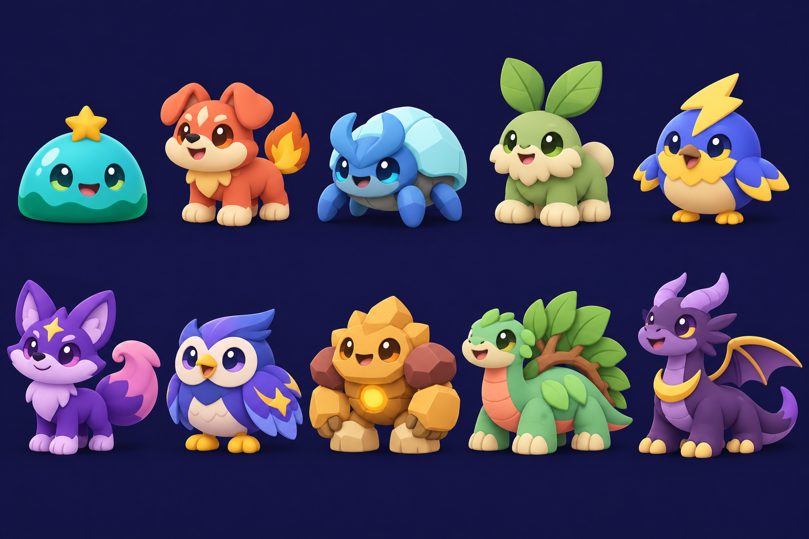

# Starfall Ranch launch critter roster

**Stage 6 target: 108 earnable species.** Each row gives one species name, stable ID, primary meteor family, and shape reference. Bold names form the 24-species private candidate. The six existing heroes carry their current IDs and tiers. Nebula Fox remains eligible for an Astral hatch as well as its primary Frost pool. Primary families organize the Critter Index. The published pool configs will establish any secondary sources and exact odds.

| Tier | Ember | Frost | Verdant | Storm | Astral | Total |
| --- | ---: | ---: | ---: | ---: | ---: | ---: |
| Common | 6 | 5 | 5 | 4 | 4 | 24 |
| Uncommon | 5 | 5 | 4 | 4 | 4 | 22 |
| Rare | 4 | 4 | 4 | 4 | 4 | 20 |
| Epic | 3 | 3 | 3 | 3 | 4 | 16 |
| Legendary | 2 | 2 | 2 | 3 | 3 | 12 |
| Mythic | 1 | 1 | 2 | 2 | 2 | 8 |
| Secret | 1 | 1 | 1 | 1 | 2 | 6 |
| **Total** | **22** | **21** | **21** | **21** | **23** | **108** |

## Visual reference

**Top row, left to right** — Star-Slime, Cinder Pup, Frost Beetle, Moss Bun, Static Jay.  
**Bottom row, left to right** — Nebula Fox, Comet Owl, Solar Golem, Canopy Leviathan, Eclipse Dragon.

Use the original concept sheet for silhouette, proportions, and the overall soft-toy look. Round faces and big eyes carry the expression. Give each species one identifying feature that survives a small thumbnail. Keep the six v2 meshes as the implementation baseline. Prove the sculpted silhouette and detail standard on two existing critters before producing the wider roster. Check readability under actual ranch lighting, normal camera distance, and a small Index thumbnail. Follow the [Stage 6 launch model detail pass](./ART_DIRECTION.md#stage-6-launch-model-detail-pass). A rarity tier can change silhouette complexity while weight determines the bounded in-world scale. Standard, Gold, and Rainbow are finishes of the same species.

## Common (24)

| Critter | Species ID | Primary meteor | Shape and palette |
| --- | --- | --- | --- |
| **Star-Slime** | `StarSlime` | Ember | Turquoise jelly dome, dark mint base, golden star crest |
| **Toast Toad** | `ToastToad` | Ember | Flat cinnamon toad with a butter-yellow throat and wide cheeks |
| Soot Finch | `SootFinch` | Ember | Round charcoal finch with a stubby coral beak and soot wing tips |
| Flint Ram | `FlintRam` | Ember | Pebble-bodied lamb with twin terracotta curls and stubby hooves |
| Ash Ant | `AshAnt` | Ember | Graphite ant with three fat body beads and ember antenna tips |
| Sizzle Newt | `SizzleNewt` | Ember | Coral newt with a low body and a flame-shaped tail fin |
| **Snowcap Mouse** | `SnowcapMouse` | Frost | Ball-shaped blue mouse, white head cap, broad disk ears |
| **Drift Seal** | `DriftSeal` | Frost | Pale gray seal with flat flippers and a teal scarf-like neck band |
| Icicle Crab | `IcicleCrab` | Frost | Squat cyan crab with two tapered ice-block claws |
| Powder Hare | `PowderHare` | Frost | Cream hare with long powder-blue ears and oversize hind feet |
| Rime Snail | `RimeSnail` | Frost | Blue-gray snail with a snowy shell shaped like a soft-serve swirl |
| **Moss Bun** | `MossBun` | Verdant | Sage rabbit with upright paired leaf ears and a cream muzzle |
| **Acorn Snail** | `AcornSnail` | Verdant | Warm brown acorn shell with a short pea-green snail body |
| Clover Chick | `CloverChick` | Verdant | Butter chick with a three-lobed clover crest and lime wings |
| Puddle Tadpole | `PuddleTadpole` | Verdant | Teal bean body with a long curled paddle tail and round eyes |
| Mud Mole | `MudMole` | Verdant | Earth-brown mole with an oval pink nose and shovel paws |
| **Cloud Chick** | `CloudChick` | Storm | Pale lavender puff chick with a cloud-shaped rump and stubby beak |
| Sparkworm | `Sparkworm` | Storm | Canary caterpillar with four fat segments and a zigzag tail tip |
| Rain Skipper | `RainSkipper` | Storm | Indigo pond skater with a long oval body and four thin sweeping legs |
| Breeze Bat | `BreezeBat` | Storm | Sky-blue bat with giant rounded ears and low scalloped wings |
| **Moon Moth** | `MoonMoth` | Astral | Silver moth with crescent wings and a midnight body |
| Orbit Guppy | `OrbitGuppy` | Astral | Violet oval fish with a small ring-shaped tail fin |
| Dusk Hedgehog | `DuskHedgehog` | Astral | Plum hedgehog with three rows of large rounded quills |
| Stardust Gecko | `StardustGecko` | Astral | Ink-blue gecko with sticky toe pads and three large cream spots |

## Uncommon (22)

| Critter | Species ID | Primary meteor | Shape and palette |
| --- | --- | --- | --- |
| **Cinder Pup** | `CinderPup` | Ember | Coral puppy, broad cream muzzle, chunky paws and flame tail |
| Copper Armadillo | `CopperArmadillo` | Ember | Rusty oval armadillo with three broad copper shell bands |
| Hearth Hen | `HearthHen` | Ember | Warm orange hen with a glowing oven-mitt comb |
| Kiln Tortoise | `KilnTortoise` | Ember | Brick-orange turtle with a charred dome and four cream toes |
| Saffron Skunk | `SaffronSkunk` | Ember | Deep rust skunk with a wide saffron stripe on an upright tail |
| **Frost Beetle** | `FrostBeetle` | Frost | Domed cyan shell, glacier hood, four readable arched legs |
| **Glacier Otter** | `GlacierOtter` | Frost | Blue-gray otter with a broad flat fluke and icy belly patch |
| Flurry Puffin | `FlurryPuffin` | Frost | Black-and-white puffin with a sky-blue wedge beak |
| Snowbell Yak | `SnowbellYak` | Frost | Cream shaggy yak with pale blue curved horns and snow-bell fringe |
| Icefin Axolotl | `IcefinAxolotl` | Frost | Snow-white axolotl with three thick aqua gill fins on each side |
| **Bramble Fawn** | `BrambleFawn` | Verdant | Chestnut fawn with two budding twig antlers and big alert ears |
| Fern Ferret | `FernFerret` | Verdant | Long mint ferret with cream cheeks and a fern-frond tail |
| Honey Bumble | `HoneyBumble` | Verdant | Round amber bumblebee with a petal collar and cream paddle wings |
| Lily Koi | `LilyKoi` | Verdant | Pearl and turquoise koi with a lily-shaped dorsal fin |
| **Static Jay** | `StaticJay` | Storm | Cobalt fledgling with a yellow zigzag crest and rounded wing tips |
| Kite Squirrel | `KiteSquirrel` | Storm | Slate squirrel with a kite-shaped gliding membrane and high ribbon tail |
| Thunder Toad | `ThunderToad` | Storm | Gray-blue toad with a yellow throat sac and raised bolt brow |
| Wind Chime Cricket | `WindChimeCricket` | Storm | Long lavender cricket with three pendant chime shapes along its back |
| **Crescent Cat** | `CrescentCat` | Astral | Dark violet kitten with a crescent tail and silver front paws |
| Meteor Hermit | `MeteorHermit` | Astral | Tiny lilac hermit crab carrying a crater-pocked meteor shell |
| Halo Llama | `HaloLlama` | Astral | Cream llama with a small tilted ring among its fluffy head tufts |
| Twinkle Stingray | `TwinkleStingray` | Astral | Blue-purple ray with spotted fins and a tiny star tail tip |

## Rare (20)

| Critter | Species ID | Primary meteor | Shape and palette |
| --- | --- | --- | --- |
| **Kiln Crab** | `KilnCrab` | Ember | Dark brick crab with one forge-shaped oversized claw |
| Ember Badger | `EmberBadger` | Ember | Stocky burgundy badger with a bright stripe and heavy digging paws |
| Glassback Scorpion | `GlassbackScorpion` | Ember | Smoky orange scorpion with a broad translucent-looking shell and pearl stinger |
| Caldera Boar | `CalderaBoar` | Ember | Red quarry boar with cream tusks and a cinder crest |
| **Nebula Fox** | `NebulaFox` | Frost | Violet fox, tapered muzzle, curled rose-tipped tail |
| **Aurora Lynx** | `AuroraLynx` | Frost | Teal lynx with long ice ear tufts and a pink-to-lime stripe motif |
| Permafrost Penguin | `PermafrostPenguin` | Frost | Round slate penguin with a wide clear-blue ice collar |
| Shard Narwhal | `ShardNarwhal` | Frost | Short blue narwhal with a single mint spiral horn |
| **Orchid Mantis** | `OrchidMantis` | Verdant | Orchid-pink mantis with petal-shaped front claws |
| Canopy Chameleon | `CanopyChameleon` | Verdant | Green chameleon with a tight coil tail and high ochre casque |
| Amber Stag | `AmberStag` | Verdant | Amber deer with forked antlers shaped like translucent sap drops |
| Lilypad Capybara | `LilypadCapybara` | Verdant | Brown capybara with a broad square muzzle and giant jade lily-pad hat |
| **Thunder Bison** | `ThunderBison` | Storm | Slate bison with a high shoulder puff and forked lightning horns |
| Squall Squid | `SquallSquid` | Storm | Lavender squid with a swept mantle and three thick curled arms |
| Coppercoil Eel | `CoppercoilEel` | Storm | Dark blue eel with a copper ring behind the head and a spiraled tail |
| Rainshadow Raven | `RainshadowRaven` | Storm | Charcoal raven with long tail feathers and teal raindrop wing tips |
| Prism Gecko | `PrismGecko` | Astral | Pearl gecko with triangular pastel scales along a thick tail |
| Moonstone Panda | `MoonstonePanda` | Astral | Indigo and cream panda with a wide moonstone brow plate |
| Orbit Octopus | `OrbitOctopus` | Astral | Purple octopus with four broad curls framing a small ring |
| Startrail Jackal | `StartrailJackal` | Astral | Navy jackal with high ears and a sweeping pale-gold tail |

## Epic (16)

| Critter | Species ID | Primary meteor | Shape and palette |
| --- | --- | --- | --- |
| **Crown Salamander** | `CrownSalamander` | Ember | Gold-orange salamander with a three-point crest and wide heat-fan tail |
| Cinderback Rhino | `CinderbackRhino` | Ember | Terracotta rhino with one glowing wedge horn and a stepped obsidian back |
| Crater Ram | `CraterRam` | Ember | Craggy dark ram with furnace-mouth chest and broad brass spiral horns |
| Glacier Mammoth | `GlacierMammoth` | Frost | Blue woolly mammoth with pale tusks and a broad translucent ice cap |
| Moonice Koi | `MooniceKoi` | Frost | Silvery koi with two long crescent fins and a blue forehead gem |
| Boreal Griffin | `BorealGriffin` | Frost | White griffin cub with a teal wing fan and tufted cat feet |
| Sporeback Tortoise | `SporebackTortoise` | Verdant | Olive turtle with three chunky scarlet mushroom caps on its shell |
| Jade Raptor | `JadeRaptor` | Verdant | Smooth jade raptor with long toes and an upright frond plume |
| Lotus Moth | `LotusMoth` | Verdant | Mint moth with pale-pink lotus-petal wings and a short crowned body |
| **Gale Falcon** | `GaleFalcon` | Storm | White falcon with dark blue swept wings and a lightning shoulder patch |
| Monsoon Hydra | `MonsoonHydra` | Storm | Three short indigo necks above a rounded storm-cloud body |
| Nimbus Ram | `NimbusRam` | Storm | Pale lavender sheep with a broad cloud ruff and dark forked horns |
| **Solar Golem** | `SolarGolem` | Astral | Faceted ochre torso with bronze shoulders and one warm core |
| Asteroid Ape | `AsteroidApe` | Astral | Purple ape with broad stone knuckles and a small crater on either shoulder |
| Moonsail Manatee | `MoonsailManatee` | Astral | Rounded silver manatee with wide crescent flippers |
| Cosmic Cuttlefish | `CosmicCuttlefish` | Astral | Ink-blue cuttlefish with a wide lavender skirt and gold pupil band |

## Legendary (12)

| Critter | Species ID | Primary meteor | Shape and palette |
| --- | --- | --- | --- |
| Suncore Phoenix | `SuncorePhoenix` | Ember | Ochre phoenix with a broad sun-disk tail fan and coral wing edges |
| Forgeback Dragon | `ForgebackDragon` | Ember | Dark brick dragon with a rounded furnace chest and copper wing blocks |
| Glacier Basilisk | `GlacierBasilisk` | Frost | Turquoise basilisk with thick crystal fins and a tall hooded head |
| Borealis Kirin | `BorealisKirin` | Frost | Cream kirin with clipped aqua mane, ribbon tail and one curved horn |
| Orchard Drake | `OrchardDrake` | Verdant | Apple-green drake with a curled branch tail and orchard-blossom shoulder wings |
| Grove Colossus | `GroveColossus` | Verdant | Walnut-colored forest guardian with one massive root arm and a mossy head |
| Tempest Serpent | `TempestSerpent` | Storm | Ultramarine storm serpent with a long Z-shaped body and yellow cheek fins |
| Skyrail Roc | `SkyrailRoc` | Storm | White giant nestling with broad arrow-shaped wings and an amber beak |
| Boltback Kraken | `BoltbackKraken` | Storm | Cobalt kraken with four lightning-bent arms around a blunt round head |
| **Comet Owl** | `CometOwl` | Astral | Plump indigo owl, cream eye mask and swept comet wings |
| Ringtail Sphinx | `RingtailSphinx` | Astral | Plum sphinx with a cream mane and thick loop-shaped tail |
| Quasar Giraffe | `QuasarGiraffe` | Astral | Indigo calf with a long neck, short gold ossicones and orbit chest emblem |

## Mythic (8)

| Critter | Species ID | Primary meteor | Shape and palette |
| --- | --- | --- | --- |
| Mantle Titan | `MantleTitan` | Ember | Dark basalt giant with broad rounded shoulders and a narrow molten collar |
| Polar Crown Whale | `PolarCrownWhale` | Frost | White whale with a wide crown of aqua fins and a heavy rounded fluke |
| **Canopy Leviathan** | `CanopyLeviathan` | Verdant | Squat mint sauropod with a woody fern sail and coral underside |
| Bramble Behemoth | `BrambleBehemoth` | Verdant | Dark green low-slung beast with a rose-thorn carapace and roots for toes |
| Cyclone Kirin | `CycloneKirin` | Storm | Lilac long-legged kirin with a spiral funnel mane and yellow forehead bolt |
| Thunderhead Dragon | `ThunderheadDragon` | Storm | Deep blue dragon with two cloud-shaped wings and a split amber tail |
| Starforge Colossus | `StarforgeColossus` | Astral | Bronze celestial golem with one orbital shoulder arc and a violet star core |
| Lunar Chimera | `LunarChimera` | Astral | Silver lion cub with a second crescent-shaped ram head and a long dark tail |

## Secret (6)

| Critter | Species ID | Primary meteor | Shape and palette |
| --- | --- | --- | --- |
| Sunvault Lion | `SunvaultLion` | Ember | Charcoal lion with a gold disk mane, ruby muzzle and heavy paws |
| Zero Hour Kirin | `ZeroHourKirin` | Frost | Near-white kirin with a pale blue hourglass ring and a long ice ribbon mane |
| Worldroot Warden | `WorldrootWarden` | Verdant | Ancient tortoise with a single miniature tree rising from a jade shell |
| Eye of the Tempest | `EyeoftheTempest` | Storm | Midnight manta with circular eye-like wing marks and sweeping lightning edges |
| Silent Nova | `SilentNova` | Astral | Pearl cosmic jelly with a perfectly round dark core and three chunky gold ribbons |
| Eclipse Dragon | `EclipseDragon` | Astral | Deep plum dragon with golden crescent collar, curved violet horns and gold-edged bat wings |

See [Critter Index progression and rewards](./STARFALL_RANCH_GAMEPLAY_PLAN.md#critter-index) for collection rules and milestones.
