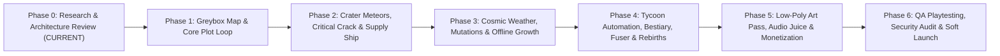

# Phased Development Roadmap (Beginner-Friendly)

> **Last Updated:** November 15, 2026  
> **Author:** Gemini (Primary Project Lead)  
> **Reviewer:** ChatGPT (Independent Technical Director)  
> **Target Audience for This Document:** A beginner developer in Roblox Studio, Luau, and Blender working alongside AI coding agents.

---

## 1. Beginner's Glossary: Key Roblox & Workflow Concepts Explained Simply

Before diving into the phases, here are plain-English explanations of the core tools and concepts used in our technical plan:

- **Server vs. Client:**
  - **The Server (`ServerScriptService`)** is the referee. Only one server runs per 6-player match. It keeps track of everyone's true coins, inventory, and plot timers so nobody can cheat.
  - **The Client (`StarterPlayerScripts`)** runs on each player's individual phone, tablet, or PC. It draws buttons on the screen, plays sound effects, and makes critters hop smoothly.
- **ReplicatedStorage:** A shared folder that **both** the Server and the Client can read. We put our item lists (`CritterConfig`, `MutationConfig`) and 3D model templates here so both sides know what a *"Golden Star-Slime"* looks like and how much it is worth.
- **RemoteEvents & RemoteFunctions:** The walkie-talkies between the Client and the Server. When a player taps the `[Plant Geode]` button on their screen (Client), it sends a message over a `RemoteEvent` to the Server saying *"Hey referee, I want to plant Geode #1 in Bed #1!"*
- **DataStoreService:** Roblox's built-in cloud database that saves a player's coins, critters, and plot upgrades when they leave the game and loads them back when they return.
- **ProximityPrompt:** The built-in Roblox interactive button (`Hold E` on PC / `Tap Icon` on Mobile) that pops up automatically when your character walks near an object like a Meteor, Soil Bed, or another Player. Using `ProximityPrompt`s saves us from writing complicated custom raycast/touch detection code!
- **Rojo (`default.project.json`):** A free tool that connects files on your computer (inside our `src/` folder in Git) directly into Roblox Studio in real time. This lets AI agents (Gemini and ChatGPT) write and edit `.luau` code files directly in your repository without you having to copy-paste 20 scripts by hand. *(Note: Even if you don't install Rojo right away, our folder structure matches Roblox Studio 1-to-1 so copy-pasting is effortless).*

---

## 2. Roadmap Overview (6 Manageable Phases)

---

## Phase 0: Research, Planning & Technical Review *(Current Phase)*
- **Objective:** Establish a research-backed game design, complete technical specification, and GitHub repository; obtain independent review and approval from ChatGPT (Technical Director).
- **Tasks:**
  - [x] Conduct 2025–2026 Roblox market & algorithm research (`MARKET_RESEARCH.md`).
  - [x] Extract 8 core retention/viral trends (`TREND_ANALYSIS.md`).
  - [x] Generate & score 12 original concepts; select Top 3 and #1 recommendation (`GAME_CONCEPTS.md`).
  - [x] Draft GDD, Technical Architecture, Roadmap, Art Direction, and Monetization docs.
  - [ ] Push local Git repository to GitHub remote (`roblox-game-project`).
  - [ ] Complete ChatGPT independent review in `docs/AGENT_REVIEWS.md` and resolve open questions in `docs/DECISIONS.md`.
- **Definition of Done:** All documentation files committed to `main`, reviewed by ChatGPT, and signed off by the human project lead.

---

## Phase 1: Studio Setup, Greybox World & Core Plot Data Loop
- **Objective:** Get a player spawning onto a claimed Ranch Plot made of simple colored Roblox Parts, planting a starter Geode/Pod, watching it grow, and earning their first Starlight Coins.
- **Dependencies:** Phase 0 sign-off.
- **Features & Tasks:**
  1. **Workspace Greybox Map (Roblox Studio Parts Only):**
     - Create a flat central circle (`CentralCrater`, radius 80 studs), a small `SupplyPlaza` platform, and 6 identical `Plot_1`..`Plot_6` models (60x60 studs each).
     - Inside `Plot_1`, place 4 simple brown Part cylinders (`SoilBed_1`..`4`), 2 glowing cyan pads (`Incubator_1`..`2`), 1 fenced square zone (`CritterPen`), and 1 `VaultCollector` pad. Duplicate to `Plot_2`..`Plot_6`.
  2. **Shared Configuration & Math Modules (`src/Shared/`):**
     - Implement `Types.luau`, `Constants.luau`, `CritterConfig.luau` (8 species), `CrystalConfig.luau` (6 geodes), `MutationConfig.luau` (8 mutations), and `EconomyMath.luau`.
  3. **DataService & PlotService (`src/Server/`):**
     - Implement `DataService.luau` (with Studio mock fallback if API Services aren't enabled yet).
     - Implement `PlotService.luau` to assign an empty plot on `PlayerAdded`, release it on `PlayerRemoving`, and handle planting/incubating/harvesting via `ProximityPrompt`s.
  4. **Basic Client Visuals (`src/Client/`):**
     - Implement `PlotVisualController.luau` so planted crystals scale smoothly from small to full size and hatched blocky critters hop inside the pen and add coins to the player's HUD counter.
- **Testing Requirements:**
  - Start a **Local Server (2 Players)** in Roblox Studio (`Test -> 2 Players`).
  - Verify Player 1 gets `Plot_1` and Player 2 gets `Plot_2`.
  - Plant a starter Geode and starter Pod; verify they mature after 10 seconds, award coins when harvested/hatched, and persist when rejoining.
- **Definition of Done:** A player can claim a plot, plant/hatch items, see hopping blocky critters generating passive coins, and sell harvested crystals at the Merchant NPC.

---

## Phase 2: Active Crater Loop, "Critical Crack" Minigame & 5-Min Supply Ship
- **Objective:** Make the first 3 minutes of active gameplay tactile and exciting by adding falling Crater Meteors, the 1.5-second **Critical Crack** skill bar, and the synchronized **Orbital Supply Ship** shop.
- **Dependencies:** Phase 1 completed.
- **Features & Tasks:**
  1. **MeteorService (`src/Server/Services/MeteorService.luau`):**
     - Spawn up to 8 active wild Star-Meteors inside the `CentralCrater` zone with a 20-second respawn timer.
     - Implement server-validated timing window checks for `RequestStartCrack` and `RequestFinishCrack`.
  2. **CrackMinigameController (`src/Client/Controllers/CrackMinigameController.luau`):**
     - Build a clean curved progress bar UI (`ScreenGui`) with a 60% Green zone and 15% Gold ("Critical!") sweet spot.
     - Add camera FOV punch (`70 -> 66 -> 70`), hammer swing/beam effect, and floating `+Weight Bonus!` text on Gold hits.
  3. **SupplyShipService & Shop UI:**
     - Generate synchronized 5-minute stock using `math.floor(os.time() / 300)` as the random seed.
     - Build the Supply Ship Shop UI showing live stock counts and countdown timer.
- **Testing Requirements:**
  - Test hitting the Gold Zone vs. Green Zone on 10 meteors; verify Gold hits consistently produce `1.35x` heavier pods/geodes and double-check that spam-clicking cannot bypass the server cooldown.
  - Verify the Supply Ship restocks cleanly when the 5-minute clock rolls over.
- **Definition of Done:** Players can alternate seamlessly between cracking wild meteors in the Crater and buying rare restocks from the Supply Ship to keep their Ranch beds full.

---

## Phase 3: Cosmic Weather Engine, Mutation Stacking & Offline Progression
- **Objective:** Bring the signature retention hook online—dynamic server weather that mutates growing items into glowing, giant variants, plus the *"While You Were Away"* offline calculation.
- **Dependencies:** Phase 2 completed.
- **Features & Tasks:**
  1. **WeatherService & Visuals:**
     - Implement the 6-minute cycle (4m Clear / 2m Active Cosmic Weather).
     - Every 20 seconds during active weather, roll mutation chances on all growing Geodes and Pods across all occupied plots.
     - Implement `WeatherVisualController.luau` to smoothly tween `Lighting` colors, skyboxes, and screen-space rain/solar particles.
  2. **Visual Mutation Applier (`src/Shared/Util/MutationVisuals.luau`):**
     - Write a single helper module that takes any 3D Crystal or Critter model and applies its `WeightKg` scale (`Model:ScaleTo(...)`) plus material/color/particle tags for all 8 mutations (*Colossal*, *Wet*, *Solar*, *Frost*, *Shocked*, *Golden*, *Void*, and *Prismatic*).
  3. **Offline Growth & Welcome Back Card:**
     - In `DataService.luau`, compute elapsed offline seconds on login, roll fair offline weather mutations for growing beds, calculate offline critter coin earnings, and fire `OfflineReportReady` to display the Welcome Back summary UI.
- **Testing Requirements:**
  - Use a Studio command bar snippet to force-trigger each of the 5 Weather Events (`WeatherService:ForceWeather("SolarFlare")`) and verify growing crops visually gain orange neon cores and `4x` value multipliers.
  - Simulate a 4-hour offline gap by setting `LastSeenTimestamp = os.time() - 14400` in Studio test mode and verify the Welcome Back popup calculates coins and matures all beds accurately.
- **Definition of Done:** Weather shifts feel dramatic, mutations visibly stack and multiply values accurately, and logging back in after time away feels immediately rewarding.

---

## Phase 4: Tycoon Automation, Star-Fuser, Bestiary & Social Systems
- **Objective:** Complete the mid-to-late-game progression loops (Upgrades, Drones, 5-to-1 Fusion, Bestiary Index, Rebirths) and social hooks (Hold-to-Flex, Gifting, Likes, Co-Play buff).
- **Dependencies:** Phase 3 completed.
- **Features & Tasks:**
  1. **Plot Upgrade Pads & Collector Drones:**
     - Add physical step-on upgrade buttons on the back deck of each plot (`+2 Soil Beds`, `+1 Pen Slot`, `Unlock Collector Drone`, `Unlock Weather Conduit`).
     - Render a cute hovering Drone model that flies in a loop over the player's pen collecting coins automatically.
  2. **Star-Fuser (5-to-1) & Rebirth System:**
     - Build the Fuser UI and server validation (`RequestFuseCritters`) turning 5 identical critters into a `3.5x` **Starforged** variant.
     - Implement **Rebirths 1–3**, resetting cash/basic beds while preserving Bestiary, Starforged/Locked items, and unlocking plot expansions.
  3. **Cosmic Bestiary UI:**
     - Grid UI showing discovered species, personal weight records, and mutation stamps, plus automatic milestone buffs every 10 stamps.
  4. **Social Features:**
     - **Overhead Carry:** Equipping an inventory item welds a visual clone above the player's head with a rarity `BillboardGui`.
     - **Proximity Gifting & Trophy Pedestal:** Add `ProximityPrompt`s for gifting items to nearby players and liking front-gate Trophy Pedestals.
     - **Mega-Geode Co-Op Event:** Spawn the giant central co-op meteor every 15 minutes.
- **Testing Requirements:**
  - Test 2-player Proximity Gifting and Trophy Likes in Studio Local Server; verify friend presence applies the `+10%` Co-Play luck/coin buff.
  - Test Rebirth 1 reset behavior to confirm locked/favorited critters are **never** wiped.
- **Definition of Done:** Full end-to-end MVP gameplay loop is playable from 0 coins through Rebirth 3 and 100% Bestiary tracking.

---

## Phase 5: Stylized Art Pass (Blender + Python), Audio Juice & Ethical Monetization
- **Objective:** Replace greybox Part placeholders with polished low-poly meshes (using our automated Blender Python scripts), add crisp audio/tween juice, and wire up ethical GamePasses and DevProducts.
- **Dependencies:** Phase 4 completed.
- **Features & Tasks:**
  1. **Blender Python Asset Generation (`tools/blender/`):**
     - Run our procedural Blender Python scripts (detailed in `ART_DIRECTION.md`) to generate beveled Crystal clusters, octagonal Geodes, and 8 adorable blocky Critter meshes; import as `.fbx` into `ReplicatedStorage.Assets`.
  2. **Audio & UI Polish:**
     - Hook up pitch-ascending coin chimes, weather sirens, Critical Crack dings, and `2.5s` Mythic hatch celebration flashes.
     - Audit mobile UI scaling in Roblox Studio's **Device Emulator** (`iPhone SE`, `iPad Mini`, `1080p PC`).
  3. **MonetizationService (`src/Server/Services/MonetizationService.luau`):**
     - Implement `MarketplaceService.ProcessReceipt` (with idempotent receipt logging in DataStore so purchases never fail to grant) for **Server Weather Beacons** and **Starter Pack**, plus GamePass checks for **Auto-Crack Drone**, **+3 Pen Equips**, and **2x Storage**.
- **Testing Requirements:**
  - Test every GamePass and Developer Product in Roblox Studio using mock test purchases.
  - Run the game in the Studio Mobile Emulator (`iPhone 12` & `Low-End Tablet`) and verify zero overlapping UI buttons and `< 400 MB` client memory usage.
- **Definition of Done:** Game looks vibrant, sounds punchy, runs at 60 FPS on mobile emulator, and processes test purchases safely.

---

## Phase 6: Security Audit, Playtesting & Soft Launch
- **Objective:** Harden server security, validate telemetry, and launch to an initial test cohort to measure real D1/D7 retention and First-Play Bounce Rate.
- **Dependencies:** Phase 5 completed.
- **Features & Tasks:**
  1. **ChatGPT & Gemini Joint Security Audit:**
     - Stress-test every `RemoteEvent`/`RemoteFunction` with invalid types, negative numbers, `NaN`, rapid-fire spam, and out-of-range coordinates.
  2. **Roblox Analytics Instrumentation (`AnalyticsService`):**
     - Log funnel events for Onboarding steps: `Step1_ClaimedPlot` $\rightarrow$ `Step2_FirstMeteorCracked` $\rightarrow$ `Step3_FirstPodPlanted` $\rightarrow$ `Step4_FirstCritterHatched` $\rightarrow$ `Step5_FirstUpgradeBought`.
  3. **Friend & Family Playtest (6-Player Full Server):**
     - Observe a real 15-minute session without giving verbal instructions; fix any onboarding step where a player hesitates for more than 10 seconds.
- **Definition of Done:** Zero critical/high bugs, onboarding funnel shows $>80\%$ completion of Step 4 within 90 seconds, and game is published live on Roblox!
