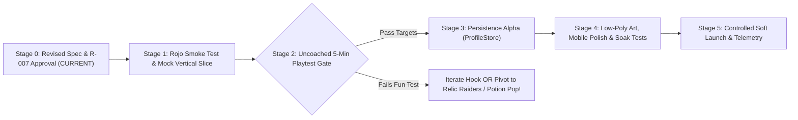

# Gated Development Roadmap (Post-Audit Revision)

> **Last Updated:** November 15, 2026 (Revised per Phase 0 Technical Director Audit — `R-006`)  
> **Author:** Gemini (Primary Project Lead)  
> **Auditor:** ChatGPT (Independent Technical Director)  
> **Core Principle:** Prove the 5-minute gameplay loop is genuinely fun with a minimal mock prototype *before* investing weeks in DataStore migrations, custom Blender catalogs, or monetization.

---

## 1. Beginner's Glossary (Core Tools & Terms)

- **Server (`ServerScriptService`) vs. Client (`StarterPlayerScripts`):** The Server is the single trusted referee (tracks true coins, pods, and meteor claims); the Client draws the UI, plays sounds, and animates hopping critters on each player's device.
- **ReplicatedStorage (`Shared`):** Shared configuration tables (`CritterConfig`, `MeteorConfig`, `UpgradeConfig`) and pure validation/math helpers readable by both Server and Client.
- **RemoteEvents & RemoteFunctions:** Client-to-Server request channels. Clients send bounded requests (like `"RequestStartCrack"`); the Server validates ownership, proximity, capacity, and nonces before changing state.
- **Rojo (`default.project.json`):** Syncs `.luau` files inside `src/` directly into Roblox Studio. Rojo is our **canonical source of truth**—manual copying is an educational fallback only, never a parallel edit workflow.
- **ProfileStore (Stage 3+):** Industry-standard, open-source Roblox DataStore wrapper with built-in session locking (protects against item duplication and crash data loss).

---

## 2. Five-Stage Gated Pipeline

> **Timeline Note:** Indicative part-time estimates for a beginner assisted by AI are ranges only—**no fixed launch date is promised**, and advancement depends strictly on passing each Stage's exit gate.

---

## Stage 0: Research Correction, Narrowed Spec & Sign-Off *(Current Stage)*
- **Objective:** Address all Phase 0 audit findings (`R-001`–`R-006`), simplify *Starfall Ranch* to a unified single-pipeline prototype, and receive Human Lead + Technical Director approval before writing any `src/` code.
- **Exit Gate (`R-007`):**
  - `docs/MARKET_RESEARCH.md`, `TREND_ANALYSIS.md`, `GAME_DESIGN.md`, `TECHNICAL_ARCHITECTURE.md`, `MONETIZATION.md`, `ART_DIRECTION.md`, and `DEVELOPMENT_ROADMAP.md` reflect the narrowed post-audit baseline.
  - Human Lead explicitly signs off on **ADR-001 through ADR-007** and authorizes Stage 1.

---

## Stage 1: Foundation + Mock Vertical Slice (`R-008` — ~1–2 Weeks Part-Time)
- **Objective:** Stand up pinned Rojo + isolated Studio place, build an idempotent tagged greybox map, and implement **one complete 5-minute playable loop** with in-memory `MockStore` profiles.
- **Scope Limits (Strictly Enforced):**
  - `2` Prototype Ranch Plots + `1` Shared Meteor Crater (`MaxPlayers = 2` initially).
  - `3` Meteor Traits (*Ember*, *Frost*, *Astral*) $\rightarrow$ `3` Species (*Star-Slime*, *Nebula Fox*, *Solar Golem*) $\rightarrow$ `1` Currency (`Coins`) $\rightarrow$ `3` Visible Ranch Upgrades (`PenSlot_2`, `Incubator_2`, `PenSlot_3`).
  - Zero real DataStores, zero weather/shop clocks, zero monetization, zero gifting/trading.
- **Tasks:**
  1. Pin Rojo version, create `src/Shared`, `src/Server`, and `src/Client` directories mapped by `default.project.json`, and smoke-test sync in an isolated Studio place (explicitly documenting which Workspace nodes are unmanaged vs. Rojo-managed).
  2. Write `tools/studio/GenerateGreyboxMap.luau` with an idempotent tagged root (`StarfallGreyboxRoot`), unique slot IDs, dry-run/confirmation check before replacing existing test nodes, and zero destructive deletion of unrelated Studio assets.
  3. Implement `NetworkService`, `DataService` (Mock adapter), `EconomyService` (single item map + bounded integer math), `PlotService`, `MeteorService` (server nonce + distance checks), and lightweight `PlotVisualController` + accessible `UIController` (Touch/Keyboard/Gamepad, Mute, Reduced Motion) + tiny audio/hatch feel pass.
- **Verification & Exit Criteria:**
  - 2-player Studio Local Server test passes: independent plot assignment, meteor rescue choice, hatch, Keep-vs-Sell, and upgrade purchases.
  - Adversarial tests pass: simultaneous 2-player crack race, forged/expired `AttemptNonce`, out-of-range finish, `NaN`/negative/wrong-type remote fuzzing, bag-full rejection before meteor consumption, and mid-crack respawn/disconnect.

---

## Stage 2: Discovery Playtest Gate (`R-009`)
- **Objective:** Validate whether the core 5-minute Meteor Rescue & Critter Keep-vs-Sell loop is genuinely fun and legible **without coaching**.
- **Test Protocol:**
  - Observe **5–10 consenting testers** (ideally mixing mobile and desktop; guardian consent for minors; zero personal data collected) in an isolated test build for 5–15 minutes without verbal instructions.
- **Directional Acceptance Hypotheses (Not Statistical Proof):**
  - Most testers understand the first meteor rescue and incubation action without help.
  - $\ge 80\%$ hatch and place their first Critter within **90 seconds**; median first reward $\le 45\text{s}$.
  - $\ge 70\%$ **voluntarily initiate a second/third meteor rescue within 5 minutes** (proving active Crater engagement rather than passive coin waiting).
  - Qualitative enjoyment beyond numbers going up (choosing meteor traits, showing/visiting ranches).
- **Decision Gate:** Proceed to Stage 3, iterate the Crater rescue choice, **or pivot to *Relic Raiders* / *Potion Pop!*** before investing in persistence and art.

---

## Stage 3: Persistence Alpha (~1–2+ Weeks Part-Time)
- **Objective:** Replace `MockStore` with pinned `ProfileStore`, enable **offline pod incubation only** (`MaturesAt`), scale to `2–6` plots, and verify zero data-loss or duplication bugs.
- **Tasks:**
  1. Vendor pinned `MadStudioRoblox/ProfileStore` inside `src/Server/Libs/ProfileStore/` (preserving MIT license and recording exact commit/tag).
  2. Wire `DataService` lifecycle (`StartSessionAsync`, cancellation on early leave, `OnSessionEnd` lock-loss handling, `Profile:Reconcile()`, `BindToClose`, separate Dev/Alpha DataStore prefix).
  3. Scale greybox map cleanly to `6` plots (`MaxPlayers = 6`) with `PublicPlotDTO` late-join resync and cleanup on plot reuse.
- **Verification & Exit Criteria:**
  - Full persistence failure-injection suite passes: load/save/rejoin preservation, forced `DataStore` failure (clean kick with zero silent blank overwrite), overlapping dual-server lock theft (`OnSessionEnd`), shutdown flush (`BindToClose`), and offline `MaturesAt` boundary tests (`1s` before vs `12h` after).
  - 6-player full-server exploit & rate-limit matrix passes.

---

## Stage 4: Mobile Polish, Low-Poly Hero Art & Performance Beta (~1–3+ Weeks Part-Time)
- **Objective:** Upgrade placeholder cube critters to crisp custom low-poly Blender meshes, add optional cosmetic polish, and prove real-device stability.
- **Tasks:**
  1. **`R-010` Blender Validation First:** Export **one** test `.fbx` model (`StarSlime`) into an isolated Studio place to confirm unit scale, normals, pivot placement, and material coloring before fixing `tools/blender/generate_lowpoly_assets.py` for the 3–5 hero species + 3 meteor rocks.
  2. Add simple **Discovered Species Checklist** UI (cosmetic progress only, zero stat multipliers), **Radiant** cosmetic hatch variant (within strict $\le 30$ critters, $\le 8$ studs budget), and non-economic ranch inspection polish.
  3. Audit Touch/Keyboard/Gamepad focus navigation, mobile Safe Areas, color-blind trait icons, and `Reduced Motion` toggles.
- **Verification & Exit Criteria:**
  - 15–30 minute published full-server soak test on real low-end phone/tablet hardware passes initial **sustained $\ge 30$ FPS** target and memory baseline without frame spikes or leaks. *(Studio Device Emulator validates layout/input only, never hardware performance).*

---

## Stage 5: Controlled Soft Launch & Telemetry
- **Objective:** Publish the approved MVP scope to real users, measure anonymous funnel/retention behavior, and iterate based on evidence.
- **Tasks:**
  1. Instrument anonymous `AnalyticsService` onboarding funnel (`Spawn -> FirstMeteor -> FirstHatch -> FirstPen -> FirstUpgrade -> SecondRescue`) and economy source/sink logging.
  2. Measure organic Home vs. ad traffic cohorts, session length, Play Days, and D1/D7/D28 behavior.
  3. **Post-Stability Monetization Only:** Evaluate pure fixed-price cosmetics (Ranch Themes / Accessories) *only* after stability soak tests and Roblox child-compliance checks are explicitly signed off.
