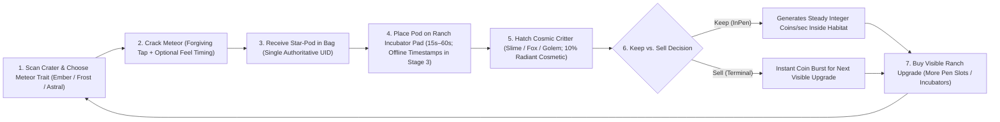

# Game Design Document (GDD): Starfall Ranch (Post-Audit Prototype & MVP Spec)

> **Last Updated:** November 15, 2026 (Revised per Phase 0 Technical Director Audit — `R-002` & `R-003`)  
> **Author:** Gemini (Primary Game Designer)  
> **Auditor:** ChatGPT (Independent Technical Director)  
> **Status:** Revised Draft v2.0 — Ready for Human Lead & Technical Director Sign-Off (`R-007`)

---

## 1. Product Strategy: Prove the 5-Minute Loop First

Per our Phase 0 audit (`docs/CHATGPT_REVIEW.md`), attempting to build a dual crystal-farming + critter-pet economy, 8 stacking multipliers, global shop timers, 5 weather events, fusion, rebirths, gifting, bosses, and monetization simultaneously creates unmanageable state bugs and obscures whether the core game is actually fun.

The release plan has four gated product layers.
1. **Stage 1–2 Vertical Slice Prototype (Build & Playtest First):** Proves the 5-minute **Meteor Rescue $\rightarrow$ Incubate $\rightarrow$ Keep-vs-Sell $\rightarrow$ Ranch Upgrade** loop with 2 plots, mock persistence, 3 species, 1 currency, and zero monetization.
2. **Stage 3 Persistence Alpha:** Adds pinned `ProfileStore` persistence, offline pod incubation (using absolute timestamps), 2–6 plots, and adversarial 2-player/6-player security testing.
3. **Stage 4–5 Private Beta & Validation:** Adds mobile and accessibility polish, low-poly hero meshes, a Discovered Species checklist, and the optional Radiant cosmetic variant. Stage 5 validates the core systems and first-session pacing in a private build.
4. **Stage 6 Launch Content & First Public Release:** Builds the full launch roster, Secret chase, and shop with gameplay passes and paid products after Stage 5. Run the final integrated test on the content-complete private build, then open that build to the public.

---

## 2. Game Overview & Differentiating Core Hook

- **Title:** *Starfall Ranch* (Working test name; alternate action-focused names like *Catch Star Critters!* to be tested honestly at Stage 5)
- **Genre:** Non-Griefing Meteor Rescue & Creature Habitat Tycoon
- **Server Size:** `2` Plots (Stage 1 Prototype) $\rightarrow$ `6` Plots Max (Stage 3+ Alpha/MVP; server `MaxPlayers = PlotCount` so every player always receives a plot cleanly)
- **Target Audience:** Ages 8–14 primary (cozy, bright, readable on touchscreens, keyboard, and gamepad).

### What Makes *Starfall Ranch* Distinct from *Break and Steal an Egg*
Because *Break and Steal an Egg* already features egg cracking and base income, *Starfall Ranch* differentiates through **Active Meteor Rescue Choice + Positive Ownership**:
1. **Scan & Choose Meteor Trails:** Instead of smacking identical nearby spawns, falling meteors streak down into the shared Crater with distinct sky trails and readable visual traits (**Ember**, **Frost**, **Astral**). Players actively read the crater and choose whether to chase a fast-hatching *Ember Meteor* nearby or sprint to an *Astral Meteor* across the crater.
2. **Zero Theft / Zero Blocking:** Players see each other rescuing meteors and can freely visit each other's ranches, without anyone blocking or stealing another player's meteor claim or ranch creatures.
3. **Unified Critter Pipeline (`ADR-002` Option B):** There is **no separate Crystal Geode lane**. Every rescued meteor yields **one Star-Pod**, which incubates into a **Cosmic Critter** that the player can either **Place in a Habitat Pen** (steady integer `Coins/s`) **or Sell at the Ranch Gate** (instant integer `Coins`).

---

## 3. Core Gameplay Loop (Unified Single Pipeline)

### First-Session Contract (Hypothesis Targets for Stage 2 Playtest)
*Note: These are directional targets to evaluate in an uncoached 5–10 player playtest—not pre-verified metrics.*
- **0–15s:** Player spawns at their claimed Ranch gate with an unobstructed view of a glowing **Starter Meteor** along the path (`Single Prompt: Tap / Hold E to Rescue`). No modal pop-ups.
- **15–45s:** Player cracks the Starter Meteor (guaranteed **Star-Slime Pod**), places it on Incubator Pad #1 (`15s`), watches a bouncy hatch animation, and places the Star-Slime in Habitat Slot #1.
- **45–90s:** First Star-Slime earns `2 Coins/s`. Player either rescues a second meteor (`Sell = 40 Coins` or `Keep`) and buys **Upgrade 1: Habitat Slot #2 (60 Coins)** within ~60–90 seconds!
- **2–5 min:** Player independently chooses Ember/Frost/Astral meteors across the crater, weighs keeping vs. selling critters against finite Pen slots, and unlocks **Upgrade 2 (Incubator Pad #2 — 150 Coins)** or **Upgrade 3 (Habitat Slot #3 — 320 Coins)**.

---

## 4. Bounded Integer Economy (`R-003`)

To eliminate runaway exponent inflation, conflicting multipliers, and tutorial/offline imbalances:
- **Single Currency Only:** `Coins` (bounded integer $\ge 0$, capped cleanly below safe integer precision limits, e.g., `1,000,000,000`). No `StarGems` in prototype or MVP.
- **Prototype economy:** Fixed species rates. Stage 6 adds bounded weight and single-mutation bonuses in Section 7.
- **Forgiving Micro-Skill:** Standard tap/hold cracks the meteor cleanly in ~1.2 seconds and grants the full Pod reward. An optional visual timing ring lets players trigger an instant flashy finish (saving ~0.5s animation flourish + joyful audio chime) **without** inflating economy values or punishing mobile lag.

### 4.1 Meteor Traits & Species Catalog (3 Prototype Species)

| Meteor Type (Crater Choice) | Visual Sky Trail & Rock Color | Primary Drop Odds | Design Trade-off |
| :--- | :--- | :--- | :--- |
| **Ember Meteor** *(Common)* | Warm orange trail & coral rock | 85% *Star-Slime*, 15% *Nebula Fox* | Fast `15s` hatch; great early cash & quick Pen filling. |
| **Frost Meteor** *(Uncommon)* | Cyan trail & ice-blue rock | 30% *Star-Slime*, 60% *Nebula Fox*, 10% *Solar Golem* | Balanced `35s` hatch; strong mid-value income. |
| **Astral Meteor** *(Rare)* | Violet-gold trail & star-crested rock | 45% *Nebula Fox*, 55% *Solar Golem* | `60s` hatch; highest steady `Coins/s` and sell value. |

| Species ID | Base Hatch Time | Pen Income (`Coins/s`) | Merchant Sell Price (`Coins`) | Keep-vs-Sell Break-Even Time |
| :--- | :---: | :---: | :---: | :--- |
| **`StarSlime`** | `15s` | `2 Coins/s` | `40 Coins` | `20s` in Pen earns `40 Coins` (Worth keeping while Pen slots are empty; sell extras once Pen is full!) |
| **`NebulaFox`** | `35s` | `4 Coins/s` | `95 Coins` | `23.75s` in Pen earns `95 Coins` |
| **`SolarGolem`** | `60s` | `7 Coins/s` | `180 Coins` | `25.7s` in Pen earns `180 Coins` |

- **Single Modest Variant (`Radiant`, 10% hatch chance):** Adds a sparkling star halo & golden trim. For gameplay testing, **either** purely cosmetic (`+0 Coins/s`, preferred in prototype) **or** capped at a fixed integer `+1 Coin/s` and `+15 Coins` sell bonus—never multiplicative.
- **Accrual & Settlement Rule:** Coins accrue strictly on the server using elapsed server time (`dt`), **settled before every rate change** (placing/removing a critter), and floored once with carried sub-second remainder (`PendingFraction`) so `2 Coins/s` for `60s` always yields **exactly `120 Coins`**.

### 4.2 Visible Permanent Ranch Upgrades (First 5–10 Minutes)

| Upgrade ID | Visual Change on Ranch | Cost (`Coins`) | Cumulative Target Time |
| :--- | :--- | :---: | :--- |
| **Starter Baseline** | `1` Incubator Pad, `1` Habitat Pen Slot, `10` Bag Capacity | `0` (Start) | `0:00` |
| **`PenSlot_2`** | Expands fenced Habitat Pen + adds glowing Slot Pad #2 | `60` | `0:50 – 1:30` |
| **`Incubator_2`** | Builds second Sci-Fi Incubator Pod beside Pad #1 | `150` | `2:00 – 3:15` |
| **`PenSlot_3`** | Widens Ranch Deck + illuminates colorful **Ranch Arch** + Slot #3 | `320` | `4:00 – 5:30` |
| *(Stage 3+ Only)* **`PenSlot_4`, `BagCap_20`, `PenSlot_5`** | Additional visible habitat expansions for 15–30m Alpha loop | `650 / 900 / 1,400` | `8:00 – 18:00` |

### 4.3 Deterministic 5-Minute Economy Simulation

| Player Path | First 60s Behavior | Time to `PenSlot_2` (`60`) | Time to `Incubator_2` (`150`) | Time to `PenSlot_3` (`320`) | Max Income @ 5:00 |
| :--- | :--- | :---: | :---: | :---: | :---: |
| **Starter (Casual)** | Hatches starter Slime (`2/s`), rescues 1 Ember Pod & sells it (`+40`), earns 20s pen income (`+40`). | **~55s** | **~2m 45s** | **~5m 15s** | `6 – 11 Coins/s` |
| **Average (Active)** | Keeps Slime #1 (`2/s`), chases Frost Meteor (`35s` hatch $\rightarrow$ Fox `4/s`), sells duplicate Slime (`+40`) while incubating. | **~50s** | **~2m 10s** | **~4m 15s** | `10 – 13 Coins/s` |
| **Lucky (Astral Early)** | Spots Astral Meteor early, incubates Solar Golem (`7/s`), fills Pen #2 & #3 with Foxes/Golems. | **~50s** | **~1m 50s** | **~3m 40s** | `15 – 21 Coins/s` |

- **Capacity & Inventory Rules:** Base Bag Capacity is `10` total committed slots (`PodInBag + HatchedInBag + reserved Incubating slots`). Attempting to crack a meteor when committed capacity is full is **rejected before meteor claim consumption** with a clear UI hint (`Bag Full! Place a hatched Critter in your Pen or Sell one at your Gate`). Favorited/active `InPen` critters cannot be accidentally sold.
- **Offline Rule:** Stage 3 enables offline pod incubation. Stage 6 adds capped offline Coins for all players and the optional 2× Offline Coins pass. Use the saved pen rate, a server-owned time cap, and one durable settlement per interval. [Launch shop](./MONETIZATION.md#3-day-one-game-passes-and-purchases)

---

## 5. Social, Accessibility & UI/UX Requirements

1. **Positive Non-Griefing Social Loop (Stage 1–4):**
   - Players see neighboring ranches, watch other players crack meteors in the Crater, and can walk onto another player's Ranch to inspect their hatched critters.
   - **Explicitly Cut from MVP:** No proximity gifting, no 2-way trading, no paid global spending broadcasts, no friend-luck multipliers, and no like-reward farming.
2. **Input & Accessibility (Built Into Prototype):**
   - Works seamlessly with **Touch**, **Keyboard (`E`)**, and **Gamepad (`ButtonX`)** via unified `ProximityPrompt`s and mobile-safe HUD buttons (`ScreenGui.IgnoreGuiInset` handled properly with safe-area padding).
   - **Never rely on color alone:** Ember, Frost, and Astral meteors have distinct **shapes/crests + icon tags** alongside color trails.
   - **Accessible Audio/Motion Settings:** Include a clean `⚙️` corner toggle for **Mute Sound** and **Reduced Motion** (disables bounce/flash effects).

---

## 6. Revised Scope Boundaries (What Was Cut vs. Deferred)

| Feature from v1 GDD | Revised Status | Reason |
| :--- | :--- | :--- |
| Separate **Crystal Geode** farming lane | **CUT** | Replaced by unified **Star-Pod $\rightarrow$ Cosmic Critter** pipeline (`ADR-002` Option B). |
| Weight and income-changing mutations | **STAGE 6** | Add bounded weight and single-mutation bonuses to the public launch economy. |
| Exponential weight scaling, mutation stacking, 5-to-1 fusion, and rebirths | **OUT OF LAUNCH SCOPE** | Launch progression uses the rates and limits in Section 7. |
| 5-Min Supply Shop Clock & 6-Min Weather Clock | **DEFERRED** | Crater is always active; players are never blocked by arbitrary restock timers. |
| Offline Coins | **STAGE 6** | Add capped offline settlement when the launch shop is built. |
| Proximity Gifting, 2-Way Trading, Global Spend Broadcasts | **DEFERRED** | Eliminates cross-profile non-atomic data risks and social spending pressure (`ADR-005`). |
| `StarGems` second currency, Streak Losses, Playtime Timers, Bosses | **CUT** | Keeps prototype focused purely on whether the 5-minute rescue/collect loop is fun. |
| Gameplay passes, shop critters, and consumable purchases | **STAGE 6** | Ship the [launch shop](./MONETIZATION.md#3-day-one-game-passes-and-purchases) with the full earnable roster. |

---

## 7. Stage 6 Collection Expansion

After the Stage 5 private baseline passes, build **24 earnable species across seven rarities** for the first public release. Ship the roster, collection book, ranch progression, and Secret chase together with the launch shop after private release-candidate testing. Paid exclusives sit outside the 24 earnable species.

### 7.1 Launch Roster and Coin Curve

These starting bands are per species before weight and mutation bonuses. Tune them in the full Stage 6 build with hatch times, sell prices, upgrade costs, wallet caps, and offline payouts.

| Critter rarity | Species | Draft base Coins/s |
| :--- | ---: | ---: |
| Common | 5 | 2–10 |
| Uncommon | 5 | 12–40 |
| Rare | 4 | 50–150 |
| Epic | 4 | 200–600 |
| Legendary | 3 | 800–2,500 |
| Mythic | 2 | 3,500–10,000 |
| Secret | 1 | 25,000 |
| **Total** | **24** | |

- **Ranch progression.** Assign explicit Starter, Expanded Ranch, and Observatory stages to visible ranch upgrades. Starter meteor pools favor Common and Uncommon. Later stages open more Rare/Epic opportunities, then Legendary/Mythic hunts. Use server-owned pool tables to define the changes per stage. The upgrade tiers affect access and odds, while each species sets its base rate. Preserve the guaranteed first Star-Slime at 2 Coins/s and privately test the early unlock times against the current baseline.
- **Meteor types and Secret.** Keep Ember, Frost, and Astral with distinct pools. Eclipse Dragon is the single earnable Secret from regular Astral Star-Pods, with equal per-pod Secret odds for paid and free players at the same progression stage. The collection book shows a silhouette and the hint *“Something stirs inside Astral Star-Pods.”* Discovery reveals the critter with a Reduced Motion-compatible hatch animation.
- **Late-game upgrades.** Add Coin sinks and ranch goals that justify high income, such as later habitats and the Observatory. Tune early, mid, and late costs alongside rates. Keep active rescues and incubation relevant, and test the combined effect of multiple active pens, the 2× offline pass, and the highest allowed critter rates.

### 7.2 Weight and Income Mutations

- **Weight:** Every species has a reference weight. Roll a discrete weight band per critter and show the resulting kilograms. The initial bands are Normal (1× reference weight, **1.00× income**), Heavy (2×, **1.50× income**), and Colossal (3×, **2.00× income**). Scale individual visuals within the existing mobile art limits.
- **Mutations:** Each critter can hold one income mutation. Start with Gilded (**1.25×**), Frostbound (**1.75×**), and Prismatic (**2.50×**). Unmutated critters use **1.00×**. Radiant remains a cosmetic variant.
- **Pen income:** Compute `floor(species base Coins/s × weight bonus × mutation bonus)` on the server, then enforce per-critter and total pen-rate caps. A 2,000 Coins/s Legendary with Colossal weight and Prismatic mutation earns **10,000 Coins/s** before a ranch-wide cap. The launch table's maximum combined bonus is **5×** the species base.
- **Collection and saves:** Show rarity, weight in kg, mutation, and actual Coins/s on each critter card. Persist the server-rolled traits and use the same server calculation for pens, the displayed rate, and the offline rate snapshot. Give existing critters Normal weight and no income mutation when adding the fields.
- **Verification:** Test every rarity's earnable path, weight and mutation bounds, saved critters, the top-end economy, and Secret discovery pacing on private builds. For paid products, verify that the displayed odds cover all randomized outcomes the offer can produce.

Design reference for species, weight, and mutation as separate drivers of income. [Steal An Egg on Roblox](https://www.roblox.com/games/107778070777162/Steal-An-Egg) · [Community income calculator](https://stealnegg.com/income-calculator/)
