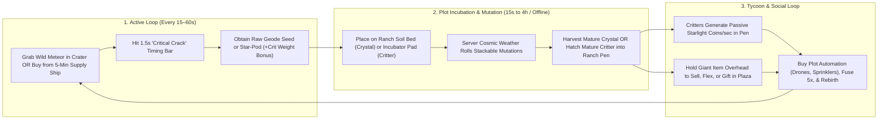

# Game Design Document (GDD): Starfall Ranch: Critter & Crystal Tycoon

> **Last Updated:** November 15, 2026  
> **Author:** Gemini (Primary Game Designer & Research Lead)  
> **Reviewer:** ChatGPT (Independent Technical Director)  
> **Status:** Draft v1.0 — Ready for Technical Review

---

## 1. Game Overview & Unique Selling Point (USP)

- **Title:** *Starfall Ranch: Critter & Crystal Tycoon* (Working Short Title: *Starfall Ranch*)
- **Genre:** Hybrid Mutation Simulator / Plot Automation Tycoon / Creature Collector
- **Server Size:** 6 Players per Server (6 symmetrical floating Ranch Plots arranged around a central Meteor Crater & Orbital Plaza)
- **Elevator Pitch:**  
  Crack falling cosmic meteors using a snappy timing bar, plant glowing **Crystal Geodes** and incubate adorable blocky **Star-Pods** on your floating ranch (even while offline!), and watch dynamic **Cosmic Weather Storms** mutate them into giant, prismatic passive-income generators that you can show off, fuse, or gift to friends!

### Unique Selling Point (Why Players Choose This Over Existing Games)
1. **Never a Dead Moment (Active + Passive Synergy):** In pure farming games (*Grow a Garden*), once your crops are planted, you sit around waiting. In *Starfall Ranch*, while your plot incubates pods and crystals, wild **Star-Meteors** continuously crash into the central Crater every 20–30 seconds for active **Critical Crack** harvesting.
2. **Living, Hopping Mutations:** Instead of only growing static fruits that sit in a 2D backpack, your incubated **Star-Pods** hatch into cute, blocky 3D **Cosmic Critters** (*Star-Slimes*, *Crystal Foxes*, *Nebula Pups*, *Solar Golems*) that physically hop around your Ranch Pens dropping passive currency and scaling up to **35+ studs tall** when they roll a **Colossal / Prismatic** mutation.
3. **Mobile-First Offline Respect:** Full offline growth and drone coin collection mean kids on mobile/tablets get a massive reward every time they log in after school without needing overnight AFK macros.

---

## 2. Target Audience & Platform Profile

- **Primary Demographic:** Ages 8–14 (Boys & Girls equally; colorful cosmic/pastel palette avoids overly gendered tropes).
- **Secondary Demographic:** Ages 14–18 completionists, traders, and short-form content creators chasing rare `1-in-50,000` multi-mutated Colossal critters.
- **Hardware Baseline:** 70%+ Mobile/Tablet (iOS/Android), 20% Low-to-Mid PC/Laptop, 10% Console.
  - *Design Mandate:* Every interaction must work with a single tap or `ProximityPrompt`; UI must use `Scale` with zero clutter in mobile thumb-stick zones; part count and animations must stay locked at 60 FPS on a 4-year-old tablet.

---

## 3. Core Gameplay Loop



### First 120 Seconds Onboarding Flow (Zero-Popup Rule)
- **0:00 – 0:10:** Player spawns directly at the gate of their assigned **Ranch Plot** (with their avatar name & icon on a glowing arch). No Robux pop-ups block the screen.
- **0:10 – 0:25:** A golden guiding beam points 20 studs ahead to a glowing **Starter Meteor** that just landed on their plot entrance. Player taps `Crack!` and hits the super-forgiving starter **Critical Crack** bar $\rightarrow$ confetti bursts, awarding `1x Sprout Geode` and `1x Star-Slime Pod`!
- **0:25 – 0:50:** Guiding beam leads to the **Incubator Pad** (`Plant!`). The starter pod grows in **10 seconds**, turns **Golden (2x)** via a scripted welcome tutorial sunbeam, and hatches into a cute bouncing **Golden Star-Slime** that immediately starts popping out `+5 Starlight Coins/sec`.
- **0:50 – 1:30:** Player collects coins, steps on their first **Ranch Upgrade Pad** (`Unlock Soil Bed #2 - 25 Coins`), and sees the central **Meteor Crater** where a live Meteor Shower is starting with other players.

---

## 4. Progression, Math & Reward Systems

### 4.1 Dual Collectible Categories: **Crystals (Burst Cash)** vs. **Critters (Passive Income)**
To prevent the economy from feeling one-dimensional, players manage two complementary plot zones:

| Category | Where It Grows | How It Rewards the Player | Role in Economy |
| :--- | :--- | :--- | :--- |
| **Crystal Geodes** *(6 MVP Tiers)* | Planted in **Crystal Soil Beds** (8–24 slots per plot) | Harvested once (or multi-harvest for high tiers) and **Sold at the Orbital Merchant** for a massive instant burst of **Starlight Coins**. | **Burst Capital:** Used to afford expensive Supply Ship restocks or the final push before a Rebirth. |
| **Star-Pods (Critters)** *(8 MVP Species)* | Incubated on **Incubator Pads**, then roam inside **Ranch Habitat Pens** (4–10 active slots) | Continuously drop **Starlight Coins every 3 seconds** directly onto the ranch (and into Offline Vaults). Can also be picked up, held overhead, fused, or sold. | **Steady Tycoon Engine:** Scales passive income per second (`Coins/s`). |

### 4.2 Value & Mutation Formula
Every harvested Crystal and hatched Critter rolls a **Weight (`kg`)** and zero or more **Mutations**:

$$\text{Value} = \text{BaseValue} \times \left(\frac{\text{WeightKg}}{\text{BaseWeightKg}}\right)^{1.25} \times \text{TierFusionMult} \times \left(1 + \sum_{i} (\text{MutationMult}_i - 1)\right)$$

> *Design Note on Additive-Within-Category vs. Pure Multiplicative:* Notice that environmental mutations add their bonus multipliers together before multiplying by Base Value, Weight, and Fusion Tier (`TierFusionMult`). This prevents runaway `10^15` quadrillion hyper-inflation in Week 1 while still allowing a **Colossal (3x weight) + Starforged (3.5x fusion) + Prismatic (25x) + Supernova (15x)** drop to reach an exhilarating **~480x multiplier**!

### 4.3 MVP Mutation Table

| Mutation Name | Source / Trigger | Base Chance | Multiplier | Visual Representation (Parts / Shaders / VFX) |
| :--- | :--- | :---: | :---: | :--- |
| **Oversized / Colossal** | Critical Crack Bar + Growth Roll | 15% / 1% | `1.5x` – `4.0x` | Model scaled `1.5x` to `4.0x` larger; deep bass thud on step/harvest. |
| **Wet / Dewdrop** | *Nebula Rain* Weather (Common) | 35% per cycle | `2.0x` | Glossy `Glass`/`SmoothPlastic` reflectance + dripping water particles. |
| **Solar-Charged** | *Solar Flare* Weather | 20% per cycle | `4.0x` | Bright warm orange-gold `Neon` core + rising ember sparks. |
| **Frost-Crowned** | *Frost Nebula* Weather | 20% per cycle | `4.0x` | Translucent icy blue shell + floating snowflake particles + tiny ice crown attachment. |
| **Ion-Shocked** | *Ion Thunderstorm* Weather | 8% per cycle | `10.0x` | Crackling cyan electric beams (`Beam` / particle arcs) jumping across the model. |
| **Golden** | Innate Hatch/Harvest Roll (Anytime) | 5% base | `8.0x` | Metallic gold surface (`Metal` material, `Color3.fromRGB(255, 200, 40)`) + sparkle chime. |
| **Void-Touched** | *Void Eclipse* Weather (Rare) | 4% per cycle | `18.0x` | Deep purple/black `ForceField` outline + orbiting dark-matter rings. |
| **Prismatic** | Innate Roll (0.5%) or *Supernova* Event | 0.5% – 2% | `30.0x` | Smooth HSV rainbow color-cycling script + star-burst halo overhead. |

### 4.4 The 5-to-1 Star-Fuser & Rebirth System
- **Star-Fuser (Unlocked at Rebirth 1):** Players place **5 Critters of the same species** into the Fuser slots to create 1 **Starforged** variant (`3.5x` base output + glowing neon trim), guaranteeing that common hatches always have purpose.
- **Ranch Rebirths (5 MVP Rebirth Tiers):**
  - Requires a specific **Starlight Coin milestone** + **1 Specific Mutated Crystal/Critter sacrifice**.
  - **What Resets:** Current Coins, unplanted common geodes, and basic plot cash pads.
  - **What Keeps Permanently:** **Cosmic Bestiary progress**, **Starforged/Mythic Critters locked in Favorited Slots (up to 3)**, GamePasses, and Cosmetics.
  - **What Unlocks per Rebirth:**
    - *Rebirth 1:* `+50%` Coin Multiplier, **Collector Drone #1** (auto-gathers ranch coins), **Star-Fuser Station**, +2 Critter Pen Slots.
    - *Rebirth 2:* `+100%` Coin Multiplier, **Weather Conduit** (boosts weather mutation odds on your plot by `+25%`), +4 Crystal Soil Beds.
    - *Rebirth 3:* `+200%` Coin Multiplier, **Auto-Crack Turret** (automatically cracks wild crater meteors that land near your plot), access to the **Upper Sky-Island Bridge**.

---

## 5. Player Retention Mechanics (Engineered for the 28-Day RFY Algorithm)

1. **Offline Growth & Drone Vaults (D1–D28 Return Driver):**  
   Crops grow and Critters deposit coins into the plot's **Offline Vault** for up to **12 hours** after logout. Logging in shows the celebratory *"While You Were Away"* summary card.
2. **Synchronized 5-Minute Orbital Supply Ship (Session Extension):**  
   Every 5 minutes (`00:00`, `00:05`, `00:10`...), the Supply Ship refreshes its stock for all players on the server. Common items have 100% stock; Rare/Epic/Mythic pods have weighted probabilities (e.g., 8% chance a *Nebula Fox Pod* appears in stock), prompting server callouts.
3. **6-Minute Cosmic Weather Cycle (Active Engagement Spikes):**  
   Alternates between 4 minutes of calm **Starlight Clear** and 2 minutes of an active **Cosmic Weather Event**, announced by a dramatic skybox transition and weather siren.
4. **Cosmic Bestiary Milestones (Mid/Long-Term Goals):**  
   A visual sticker-book UI tracking all 14 MVP Species (6 Crystals + 8 Critters) and their 8 Mutation variants (112 total index stamps). Every 10 stamps unlocked grants a permanent account perk (`+5% WalkSpeed`, `+10% Critical Crack Zone Width`, `+15% Offline Vault Cap`).
5. **7-Day Login Streak & Playtime Rewards:**  
   - Session Gift Gifts at `3m`, `8m`, `15m`, `25m`, and `40m` (granting free Weather Sprinklers, Coins, and a guaranteed Golden Pod at 25m).

---

## 6. Multiplayer & Social Features

1. **Friend Co-Play Multiplier (Algorithm Boost):**  
   Every friend present in the same server grants **both players** `+10% Coin Income` and `+10% Weather Mutation Luck` (up to `+30%`), with a one-click `[Invite Friends (+10% Luck!)]` button on the top bar.
2. **Hold-Overhead Flex & Proximity Gifting:**  
   Equipping any harvested Crystal or boxed Critter raises it above the player's head at its true mutated scale. Walking up to another player displays `Hold [E] / Tap to Gift`.
3. **Front-Gate Trophy Pedestal & Likes:**  
   Players place their proudest Critter on their front-gate pedestal. Other players can tap `👍 Like Ranch!` (once per plot per session), incrementing a public counter on the plot sign and giving both players a small burst of Starlight Dust.
4. **Communal Meteor Boss ("The Mega-Geode"):**  
   Every 15 minutes, a giant **Mega-Geode** crashes into the very center of the Meteor Crater. All 6 players in the server have 60 seconds to repeatedly hit **Critical Cracks** together to shatter its outer shell—showering everyone who participated with high-tier Geodes and Pods!

---

## 7. World & Level Design

The map is a compact, bright floating sky-archipelago designed so players can see every other player's plot and giant mutated critters from the center:

```text
                  [ Plot 3 ]       [ Plot 4 ]
                        \             /
                         \           /
     [ Plot 2 ] ---- ( CENTRAL METEOR CRATER ) ---- [ Plot 5 ]
                         /     |     \
                        /      |      \
                  [ Plot 1 ]   |   [ Plot 6 ]
                               |
                    [ ORBITAL SUPPLY PLAZA ]
                 (Supply Ship, Sell Merchant,
                  Appraiser & Leaderboards)
```

- **Radius:** ~250 studs total diameter—small enough that running from your plot gate to the central Crater takes **4 seconds**, eliminating boring walking downtime.
- **Plot Layout (60x60 studs per plot):**
  - **Front Gate:** Player Name Arch, Rebirth Rank Banner, Trophy Pedestal (`👍 Likes`), and Offline Vault Collector.
  - **Left Wing:** Crystal Soil Beds (grid of glowing soil planters) + Sprinkler Conduits.
  - **Right Wing:** Incubator Pads + fenced **Critter Habitat Pen** where hatched critters bounce happily.
  - **Back Deck:** Tycoon Upgrade Buttons, Star-Fuser Station, and expandable Upper Platform (unlocked at Rebirth 2+).

---

## 8. UI/UX Direction (Mobile-First & Clutter-Free)

- **Strict "85% Clear Screen" Rule:** At least 85% of the viewport must remain unobstructed 3D gameplay at all times, especially on 16:9 mobile screens.
- **HUD Layout:**
  - **Top Center:** Compact pill showing Current Weather Event + Countdown (`☀️ Solar Flare Active: 01:14` | `🛸 Next Supply Ship: 02:45`).
  - **Top Right:** Clean currency readout (`⭐ Starlight Coins` & `💎 Star-Gems`) + `[Invite +10% Luck]` icon.
  - **Left Center (Vertical Column of 4 Crisp Icons):** `🎒 Inventory`, `📖 Bestiary`, `🚀 Teleport (Ranch / Plaza / Shop)`, `🛒 Shop`.
  - **Bottom Center:** Standard Roblox Hotbar (up to 5 active slots on mobile, 9 on PC) for holding Geodes, Pods, and Watering Tools.
- **Color-Coded Rarity Language:**
  - Common (`Grey/White`), Uncommon (`Mint Green`), Rare (`Sky Blue`), Epic (`Vibrant Purple`), Mythic (`Molten Gold/Red`), Prismatic (`Animated Rainbow Gradient`).

---

## 9. Sound & Visual Feedback ("Game Feel / Juice")

Younger players feel game quality through immediate audio-visual responsiveness:
1. **Pitch-Ascending Combo Audio:** Collecting coins or cracking meteors in sequence increases `PlaybackSpeed` by `+0.05` per hit (`1.0` $\rightarrow$ `1.5`), creating an irresistible musical scale.
2. **Squash-and-Stretch Tweening:** Every UI button, hatching pod, and hopping critter uses `Enum.EasingStyle.Back` or `Bounce` scale tweens when clicked or spawned.
3. **Floating World-Space Popups:** When a Critter drops coins or a Geode mutates during a storm, a clean `BillboardGui` floats upward (`+250 ⭐` or `⚡ ION-SHOCKED! (10x)`) and fades out over 1.2 seconds.

---

## 10. Strict MVP Scope Definition

To guarantee we ship a polished, bug-free playable game as a beginner team—avoiding scope creep—we divide features into three strict buckets:

### Bucket 1: Essential for Launch (Phase 1 MVP)
- [x] **Map:** Central Meteor Crater, Orbital Supply Plaza, and 6 claimable Ranch Plots.
- [x] **Core Active Loop:** Wild Crater Meteors + 1.5s **Critical Crack** timing bar + 15-minute communal **Mega-Geode** event.
- [x] **Core Plot Loop:** 6 **Crystal Geode** tiers (soil beds) + 8 blocky **Cosmic Critter** species (incubator pads & habitat pens).
- [x] **Mutation Engine:** Weight (`kg`) scaling (`Oversized` / `Colossal`) + **5 Launch Weather Events** (*Nebula Rain*, *Solar Flare*, *Frost Nebula*, *Ion Storm*, *Void Eclipse*) + **8 Launch Mutations** (*Wet*, *Solar*, *Frost*, *Shocked*, *Golden*, *Void*, *Prismatic*, *Colossal*).
- [x] **Retention Systems:** Synchronized 5-minute **Orbital Supply Ship** shop + **Offline Growth & Offline Coin Vault** + **Cosmic Bestiary** UI with milestone rewards.
- [x] **Tycoon & Rebirth Loop:** 10 Plot Upgrade buttons (extra beds, pen slots, Collector Drone, Sprinkler) + **3 Rebirth Ranks** + **5-to-1 Star-Fuser**.
- [x] **Social Features:** Hold-overhead item flexing, Proximity Gifting, Front-Gate Trophy Pedestal with Likes, and Friend Co-Play `+10%` buff.
- [x] **Data & Security:** Server-authoritative DataStore saving (with session-locking protection) and exploit validation.

### Bucket 2: Important, But Post-Launch Updates (Week 2–4 Updates)
- [ ] **Player-to-Player Trading Window:** Safe 2-step trade UI (Note: Proximity Gifting is sufficient and safer for Day 1 MVP launch; full trading comes in Update 1 once economy values are verified).
- [ ] **Quest NPCs & Daily Challenges:** 3 daily tasks (`Crack 10 Meteors`, `Harvest 3 Solar Crystals`) for bonus Star-Gems.
- [ ] **Appraiser NPC:** Spend Starlight Coins at the Plaza to re-roll a Critter's weight (`kg`).
- [ ] **Cosmetic Ranch Themes:** Unlockable fence, path, and island themes (*Candy Nebula*, *Cyber Station*, *Crystal Castle*).

### Bucket 3: Future Expansion Ideas (Month 2+)
- [ ] **The Crater Rift (Timed Extraction Dungeon):** Borrowing Concept #3 (*Relic Raiders*), a portal opens under the crater every 20 minutes for a 60-second hazard dash to grab Ancient Cosmic Relics.
- [ ] **Starlight Alchemy Station:** Borrowing Concept #2 (*Potion Pop!*), crush mutated crystals into funny avatar-transforming elixirs.
- [ ] **Clans / Guild Constellations:** Co-op weekly leaderboards for servers/groups.
