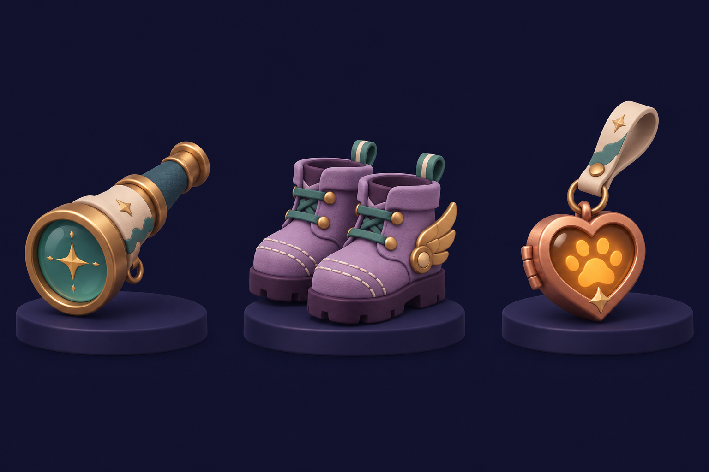

# Observatory Gear Shop and Coin progression

Make the Observatory Gear Shop the repeatable Coin goal between meteor hunts. Place the shop beside the existing Workbench at the Observatory. Unlock it after the first successful pen placement, then show the next useful purchase and a clear way back to the meteor fields.

**Rescue → Hatch → Place critters → Earn Coins → Upgrade gear → Hunt and clear tougher expeditions → Find stronger critters.** Better critters should noticeably improve ranch income on average across the five families. Size, mutation, and feeding still give older favorites a role. Cap ranch output and tune prices against ordinary lineups so a jackpot critter never becomes a prerequisite for progress.

[Open the clickable shop reference](./prototypes/observatory-gear-shop.html). It runs in a browser with the concept PNG at its repository path. The stage selector loads five illustrative ranches and the collection button simulates one minute of income for testing buy states.

## What we are borrowing

The November 23 snapshot put **Steal An Egg**, **Throw Food For Animals**, and **Fish It!** among the most-played experiences. This is a point-in-time popularity signal. [Roblox play-count snapshot](https://endgametools.com/en/roblox/charts)

| Reference | Observed mechanic | Use in Starfall Ranch |
| --- | --- | --- |
| Steal An Egg | Hatched pets generate income, and players use that money for base and speed progression. | Make stronger ranch lineups fund a visible next upgrade. Preserve Starfall's own meteor rescue and expedition loop. [Game description](https://www.roblox.com/games/107778070777162/Steal-An-Egg) |
| Throw Food For Animals | Animals earn money and better food attracts rarer animals, while new areas extend the hunt. | Connect Coins to the next meteor tier and let standard lures serve a targeted, repeatable purpose. [Game description](https://op.gg/roblox/games/10766972131) |
| Fish It! | Rods make progression visible with prices and stat comparisons across Luck, Speed, and Weight. | Show the current and next stat and what the player needs to earn or unlock it. Starfall splits the choices between hatching, travel, and expeditions. [Rod progression](https://fish-it.robloxgameswiki.com/guide/rod-progression) |

## Gear and first tuning values

Each purchase unlocks a permanent gear rank with an original cosmetic appearance and a gameplay effect. Buy one tier at a time within each line and apply only the highest owned rank of that line. Coins earned through gameplay buy all three lines. Keep the approved Robux catalog separate from this earned progression.

- **Star Lens** increases the relative pool weights of eligible Rare through Mythic outcomes. Keep Secret and finish probabilities unchanged. Apply the capped lens and Field Luck bonuses to the non-Secret portion of the pool with normalization. Start with a combined **+50% relative weight cap** for each eligible outcome. Show effective odds and allow players to switch between standard rolls and boosted rolls. Standard rolls remain eligible for the Rarest Hatch board. Keep a standard Astral route with the published Eclipse Dragon odds.
- **Trail Boots** increase overworld walk speed by a bounded percentage. Keep starter paths viable at normal speed and use the existing interaction distance and plot checks. The bonus applies while exploring the ranch, plaza and fields.
- **Bond Charm** increases damage from the player's own squad in PvE expeditions. Keep starter expeditions clearable with ordinary critters and an unupgraded charm slot. Keep squad combat role, rarity, weight, and Coins per second legible in their own places.

| Tier | Progress unlock | Example ranch Coins/s | Star Lens bonus · cost | Trail Boots bonus · cost | Bond Charm bonus · cost | Save for one from zero |
| --- | --- | ---: | ---: | ---: | ---: | ---: |
| Ember | Place your first critter | 4 | +5% · 300 | +4% · 240 | +8% · 360 | 1.0–1.5 min |
| Frost | Unlock the Frost Cracker | 16 | +10% · 2,400 | +8% · 2,000 | +15% · 3,000 | 2.1–3.1 min |
| Verdant | Rescue your first Verdant meteor | 50 | +15% · 15,000 | +12% · 12,000 | +25% · 18,000 | 4.0–6.0 min |
| Storm | Rescue your first Storm meteor | 140 | +22% · 85,000 | +16% · 70,000 | +38% · 100,000 | 8.3–11.9 min |
| Astral | Rescue your first Astral meteor | 350 | +30% · 450,000 | +20% · 360,000 | +50% · 540,000 | 17.1–25.7 min |

Prices are fixed by gear tier, with no account-specific pricing. The income column represents illustrative ordinary lineups at that stage, with increasingly strong critters and more production slots. Saving time is price divided by steady Coins per second. Tune with measured play sessions and the actual per-tier roster. Check the first choice against the existing **60-Coin second pen** and **150-Coin Frost Cracker** so players can see a useful next purchase early. Test the full time to buy a chain as well as a single tier. Adjust output and prices together using actual Coin earn and spend telemetry. Keep potions, lures and other repeatable purchases useful after a gear line reaches its cap.

## Shop UI and model handoff

| Gear | Blender model reference |
| --- | --- |
| Star Lens | Short brass scope, teal glass, four-point star and cream collar. |
| Trail Boots | Pair of lilac ankle boots with chunky soles, stitched toe caps and brass heel wings. |
| Bond Charm | Copper heart locket on a cream strap with a glowing amber paw mark. |

Use the concept render for relative proportions, materials and silhouettes. Build original production meshes and render each item separately for its thumbnail. The Gear Shop uses large illustrated cards, a pinned Coin balance and income rate, exact current and next stats, a Coin price, and an unlock or affordability message. Show locked, purchasable, owned and max-tier states. Keep prices and stats as live text. Give the luck toggle clear language about leaderboard eligibility before an affected roll. Check the layout in narrow portrait and compact landscape with touch and gamepad.

## Shipping milestones

1. **Private first pass.** Integrate all three base gear lines with one or two meteor families and an entry expedition. Verify that a player can hatch, earn, buy one useful upgrade and feel its effect in ordinary play.
2. **Launch progression.** Add all five tiers and tune the competing purchases with families, rarity, slots, upgrade costs, boosts, and offline income. Reuse the shared tier configuration wherever the UI displays prices and stats. Keep the existing Cracker and habitat unlocks in the progression map.
3. **Server and balance checks.** Reuse the existing purchase, profile and economy patterns. Validate Workbench or Gear Shop access and the exact next rank, prerequisite, and Coin balance on the server. Debit and grant in one non-yielding profile update. Restore gear on rejoin and cap luck, speed and PvE damage in the authoritative systems. Verify purchase retries, failed checks, stale card prices, and the Coin ledger. Record one Coin sink per successful purchase. Test the effective drop distribution, unchanged Secret and finish odds, standard-roll eligibility, real mobile UI, and the upgrade loop at early, mid and late game.
