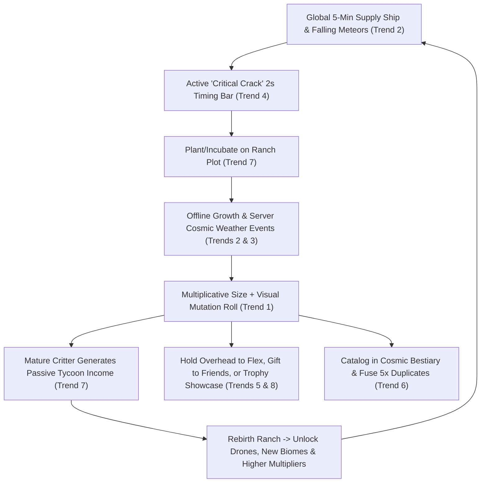

# Roblox Trend Analysis: Mechanics, Retention & Virality (2025–2026)

> **Last Updated:** November 15, 2026  
> **Author:** Gemini (Primary Research Agent)  
> **Purpose:** Distill recurring patterns from the top-performing Roblox experiences of 2025–2026 into actionable, original mechanics for our game.

---

## Overview

Rather than copying the surface theme of a hit game (e.g., making another garden clone or another fishing clone), our objective is to extract the **underlying psychological and mechanical engines** that drive:
1. **Immediate Comprehension & Fun (First 60 Seconds)**
2. **Session Depth & Micro-Goal Chaining (15–45 Minutes)**
3. **28-Day Return Frequency (D1, D7, D28 Retention)**
4. **Social Co-Play & Short-Form Video Shareability (TikTok / YouTube Shorts)**

Below are the **8 Core Trends** dominating the 2025–2026 Roblox market, structured with concrete examples, psychological drivers, retention impact, and our original adaptation strategy.

---

## Trend 1: Multiplicative Mutation & Size Stacking on Tangible 3D Objects

### 1. What the Trend Is
Instead of rewarding players with flat currency numbers or static items, modern hits generate items with **independent, stackable modifier rolls**:
$$\text{Final Item Value} = \text{Base Value} \times \text{Weight Multiplier} \times \prod (\text{Mutation Multipliers})$$
Crucially, these modifiers are **visually represented on the 3D model**—via scale (`kg` / stud size), material shaders (`Neon`, `ForceField`, `Glass`, `Metal`), color palettes (`Gold`, `Rainbow`, `Void`), and particle emitters (`Sparks`, `Frost`, `Starlight`).

### 2. Which Successful Games Demonstrate It
- ***Grow a Garden*:** Crops roll weight (`kg`) plus environmental mutations (*Wet* 2x, *Chilled* 2x, *Frozen* 10x, *Shocked* 50x, *Gold* 20x, *Rainbow* 50x, *Celestial* 120x).
- ***Fisch*:** Fish roll weight (`kg`), *Shiny/Sparkling* attributes, and mutations (*Abyssal*, *Lunar*, *Aurora* 6.5x).
- ***Throw Food For Animals*:** Animals spawn in *Gold*, *Diamond*, *Rainbow*, and giant *Infinite* mutations.

### 3. Why It Works Psychologically
Variable-ratio reinforcement works best when the reward is **combinatorial and visible**. Even a starter-tier item can suddenly roll a **Giant + Prismatic + Storm-Struck** combination, making every single harvest or hatch exciting for both new and veteran players.

### 4. How It Affects Engagement & Retention
- Eliminates "dead zones" where early-game actions feel worthless.
- Drives collection depth: players don't just want *one* Crystal Fox; they want a **Giant Aurora Crystal Fox**.

### 5. How We Will Adapt It Originally
In **Starfall Ranch**, every **Star-Pod (Critter)** and **Geode (Crystal Crop)** placed on a player's ranch has two mutation phases:
1. **Extraction Roll (Active Skill):** Hitting the golden sweet spot on the 2-second **Critical Crack** bar boosts initial **Base Weight (`kg`)** by `+25%` to `+100%`.
2. **Cosmic Exposure (Plot Growth):** While growing on the ranch, server-wide **Cosmic Weather Events** apply stackable **Elemental Infusions** (*Solar-Charged*, *Frost-Crowned*, *Nebula-Touched*, *Supernova*, *Prismatic*) that physically alter the model's procedural attachments, material glow, and passive coin output.

---

## Trend 2: Synchronized Server-Wide Weather & Global Stock Cycles

### 1. What the Trend Is
Shared world timers that change the game's economy or environment every **5 to 15 minutes** for everyone simultaneously—combining rotating merchant stock with dynamic environmental events.

### 2. Which Successful Games Demonstrate It
- ***Grow a Garden*:** Synchronized 5-minute seed shop restocks + server weather events (*Rain*, *Thunderstorm*, *Blood Moon*).
- ***Blox Fruits*:** 4-hour Fruit Dealer stock rotation.
- ***Fisch*:** Day/Night cycles, Whirlpool spawns, and player-triggered **Aurora Totems**.
- ***Steal An Egg* / *99 Nights in the Forest*:** Day/Night transition sirens that change world rules and spawn rare loot.

### 3. Why It Works Psychologically
- **"Just 2 More Minutes" Hook:** When a top-screen HUD countdown says `Next Supply Ship & Cosmic Weather in 01:42`, players rarely log off before seeing what spawns.
- **Shared Community Excitement:** When a rare 5% weather event (*Void Eclipse*) or rare stock item drops, the entire server chat lights up simultaneously.

### 4. How It Affects Engagement & Retention
Directly increases **Average Session Time** (stretching 8-minute sessions into 25-minute sessions) and drives external community engagement (players telling friends in group chats when a rare event is happening).

### 5. How We Will Adapt It Originally
We will implement a dual-clock system:
- **Every 5 Minutes (Supply Ship Dock):** The *Orbital Supply Ship* lands at the central Plaza with a fresh roll of Pod & Geode stock (with server-wide announcements if a Mythic pod is in stock).
- **Every 6 Minutes (Cosmic Weather Shift):** The skybox, lighting, and ambient audio transition into a 2-minute **Cosmic Phenomenon** (*Meteor Shower*, *Solar Flare*, *Ion Storm*, *Frost Nebula*, or the rare *Supernova*). Players can also craft or buy **Weather Beacons** to trigger an immediate event for the whole server.

---

## Trend 3: Offline Progression ("Welcome Back" Loop) Over Forced Overnight AFK

### 1. What the Trend Is
Calculating elapsed real-world time (`os.time() - lastLogoutTimestamp`) when a player joins a server and advancing their plot's growth timers, passive collectors, and deterministic weather mutation rolls accordingly.

### 2. Which Successful Games Demonstrate It
- ***Grow a Garden*:** Crops mature while the player is offline, greeting them with a *"Your garden grew while you were gone!"* banner and a plot full of ready-to-harvest produce.
- **Mobile Idle Tycoons (e.g., *Egg, Inc.*, *Slime Rancher* conservatories):** Proven mobile-first retention staple now breaking out on Roblox.

### 3. Why It Works Psychologically
- **Zero Mobile Friction:** Over 70% of younger Roblox players play on mobile/tablet devices and cannot run PC macro tools overnight (unlike *Sol's RNG* or *Pet Simulator 99*).
- **Guaranteed High-Dopamine Session Start:** Instead of logging in to an empty state or a grind wall, the first 60 seconds of every new session is a **massive reward payout** (harvesting matured pods, discovering offline mutations, and claiming collector vaults).

### 4. How It Affects Engagement & Retention
Directly maximizes **Play Days per User (D1, D7, D28)**—the #1 long-term ranking signal in Roblox's 28-day RFY algorithm—because checking your ranch before/after school takes 2 minutes and always feels rewarding.

### 5. How We Will Adapt It Originally
When a player joins **Starfall Ranch**:
1. The server compares `os.time()` against `Profile.Data.LastSeenTimestamp` (capped at a generous 12 hours of offline simulation, extendable via Ranch upgrades).
2. All planted **Crystal Geodes** and incubating **Star-Pods** advance their growth by the elapsed seconds and roll a fair baseline offline mutation chance.
3. A sleek, celebratory **"While You Were Away..."** card pops up for 4 seconds showing: Time Elapsed, Coins Gathered by Ranch Drones, and Pods Ready to Crack—with a single `[Collect & View Ranch!]` button.

---

## Trend 4: Tactile Micro-Skill Minigames Replacing Mindless Clicking

### 1. What the Trend Is
Replacing repetitive left-clicking (or holding down a button) with a snappy, 1.5-to-3-second timing or control minigame accompanied by crisp audio-visual feedback (screen shake, pitch-rising sound effects, particle bursts).

### 2. Which Successful Games Demonstrate It
- ***Fisch*:** Cast meter + tension reel bar.
- ***The Forge*:** Timed anvil hammering and quenching.
- ***Dandy's World*:** Skill-check timing rings on machines.
- ***Bee Swarm Simulator*:** Catching falling tokens, beam combos, and precise field positioning.

### 3. Why It Works Psychologically
Easy to understand in 2 seconds (*"Tap when the bar hits the gold zone!"*), yet creates a genuine sense of mastery and agency. When a player hits a **Perfect Critical Crack**, they feel *they* caused the giant rare drop.

### 4. How It Affects Engagement & Retention
Prevents boredom during active play while still coexisting peacefully with tycoon automation (once players automate low-tier pods, they save their active skill checks for high-tier Meteor Pods).

### 5. How We Will Adapt It Originally
Our signature active interaction is the **Critical Crack Bar**:
- When cracking a wild **Falling Meteor** in the Crater or opening a matured **Star-Pod**, a curved 1.5-second timing arc appears beside the object.
- **Green Zone (60% width):** Standard Crack (`1.0x` weight).
- **Gold Zone (15% width):** Critical Crack (`1.35x` weight + `+15%` Twin-Drop chance + dramatic camera zoom & chime).
- **Accessibility / Convenience:** Players who prefer purely relaxed play can still tap once for an instant standard crack, or unlock **Auto-Crack Drones** via mid-game tycoon progression.

---

## Trend 5: Physical "Hold-to-Flex", Gifting & Safe Social Interaction

### 1. What the Trend Is
Turning rare drops and mutated items into **physical 3D objects held above the player's avatar**, paired with one-click player-to-player **Gifting** and public **Showcase Pedestals**—while removing non-consensual griefing.

### 2. Which Successful Games Demonstrate It
- ***Grow a Garden*:** Holding giant mutated fruits in hand; gifting fruits to new players.
- ***Fisch*:** Holding a massive 5,000kg Megalodon or Aurora fish in the hub; Appraisal NPC flexing.
- ***Dress To Impress*:** The Runway evaluation loop.
- ***Steal a Brainrot* / *Steal An Egg*:** Carrying rare units physically across the map (though non-consensual base stealing causes rage-quits among younger kids).

### 3. Why It Works Psychologically
Younger players care deeply about **social identity and peer recognition**. Numbers in a corner leaderboard (`1.42M Coins`) are invisible and abstract; carrying a glowing, 30-stud-tall **Prismatic Nebula Dragon-Slime** through the central Plaza makes every player on the server stop and stare.

### 4. How It Affects Engagement & Retention
- **Intentional Co-Play Days:** Friends join to show off their latest mutated critters, gift starter items to help a friend catch up, and pose on showcase podiums.
- **Eliminates Rage-Quit Churn:** By replacing non-consensual plot theft with **cooperative Meteor Boss/Crater scrambles** and **voluntary Gifting/Trading**, we keep the social excitement of *Steal An Egg* without the D1 rage-quits.

### 5. How We Will Adapt It Originally
- **Overhead Carry Pose:** Any harvested Crystal or hatched Critter in the player's hotbar is held overhead with both hands using a simple procedural upper-torso/arm weld and displays a clean floating nametag (`[Giant Solar Star-Pup • 142.5 kg • 45x Value]`).
- **One-Click Proximity Gifting:** Holding an item near another player displays a `ProximityPrompt` (`Gift to [PlayerName]`) with a confirmation check for Mythic items—enabling wholesome YouTube/TikTok "Making a Noob Rich!" moments.
- **Ranch Showcase Pedestal:** Each plot has a front-gate **Trophy Pedestal** that displays the player's highest-value Critter at `1.5x` visual scale with a visitor "Like / Inspect" button (rewarding the plot owner with minor Friendship Tokens per unique visitor like).

---

## Trend 6: Collection Bestiaries, Fusion Tiers & Permanent Mastery

### 1. What the Trend Is
A structured visual catalog (**Index / Bestiary**) tracking every discovered species, weight record, and mutation variant—paired with a **3-to-1 or 4-to-1 Fusion machine** that lets players combine duplicate commons into higher-tier glowing variants.

### 2. Which Successful Games Demonstrate It
- ***Fisch*:** Island Bestiaries that gate progression and reward badges/rods.
- ***Adopt Me!*:** Combining 4 full-grown pets into a **Neon** pet, and 4 Neons into a **Mega-Neon**.
- ***Pet Simulator 99* / *Sol's RNG*:** Gold/Rainbow pet upgrading machines and aura collection indexes.

### 3. Why It Works Psychologically
- **Turns "Bad RNG" into Progress:** In a well-designed simulator, rolling a common item is never wasted if 5 commons can be fused into a **Radiant** variant, or if catching a new mutation checks off a slot in the **Bestiary** toward a permanent `+10% Ranch Income` milestone.
- **Clear Mid-Term Goals:** Answers the question *"What should I do next?"* at every stage of the game.

### 4. How It Affects Engagement & Retention
Drives **D7–D28 retention** for completionists and prevents inventory bloat.

### 5. How We Will Adapt It Originally
- **The Cosmic Bestiary UI:** A clean, visual grid showing silhouettes of undiscovered Critters and Crystals, plus checkboxes for each Mutation discovered on that species (`Normal`, `Golden`, `Solar`, `Frost`, `Nebula`, `Prismatic`). Every 10% completion grants a permanent **Starlight Mastery Boost**.
- **The Star-Fuser Station:** Located on the player's plot (unlocked at Rebirth 1), allowing players to fuse **5 identical Critters** into a **Starforged (Neon-glowing)** tier with `3.5x` passive income—keeping common pods valuable forever.

---

## Trend 7: Manual-to-Automated Tycoon Progression & Meaningful Rebirths

### 1. What the Trend Is
Blending active simulator collection with physical tycoon plot building—where upgrades unlock **visible automation** (drones, conveyors, auto-incubators, weather shields) and **Rebirths** unlock structural plot expansions and new mechanics rather than just flat stat numbers.

### 2. Which Successful Games Demonstrate It
- ***Restaurant Tycoon 3* & *Ultimate Mining Tycoon*:** Transitioning from manual actions to automated staff/machinery.
- ***Steal a Brainrot*:** Rebirthing unlocks plot capacity, base defense upgrades, and permanent multipliers.

### 3. Why It Works Psychologically
- **Tangible Sense of Growth:** Watching an empty dirt island transform into a multi-tiered neon Starfall Sanctuary with hovering collector drones, crystal conduits, and bustling critter habitats provides lasting visual satisfaction.
- **Anti-Stagnation Reset:** Rebirthing wipes short-term cash and basic pods right when numbers start getting inflated, trading them for a permanent multiplier **and** a brand-new gadget or biome bridge.

### 4. How It Affects Engagement & Retention
Provides the structural backbone for **multi-week progression (D8–D28)** and creates natural sinks for currency.

### 5. How We Will Adapt It Originally
In **Starfall Ranch**, each plot progresses through **4 Visual Tiers** and **Rebirth Ranks**:
- **Stage 1 (Manual Rancher):** Crack meteors by hand, plant geodes in 4 starter beds, collect coins dropped by 3 starter critters.
- **Stage 2 (Automated Outpost):** Unlock **Collector Drones** (which fly around your pens scooping up coins into a central vault) and **Sprinkler Conduits** (which speed up pod growth).
- **Stage 3 (Cosmic Observatory — Rebirth 1+):** Unlock the **Star-Fuser**, **Auto-Cracker Turret**, expanded habitat pens (up to 12 active critters), and access to the **Crystal Caverns & Sky Archipelago** biomes.

---

## Trend 8: "Short-Form Ready" Visual Spectacle (TikTok / YouTube Shorts Virality)

### 1. What the Trend Is
Designing visual moments, scale contrasts, and server broadcasts specifically so that a 15-second screen recording immediately hooks viewers scrolling TikTok or YouTube Shorts.

### 2. Which Successful Games Demonstrate It
- ***Grow a Garden*:** *"I grew a 10,000kg Rainbow Shocked Beanstalk that reached the skybox!"* or *"Giving a 1 Billion Sheckle Fruit to a Noob!"*
- ***Sol's RNG*:** Full-screen cinematic cutscenes when rolling a 1-in-1,000,000+ drop + global chat panic.
- ***Steal An Egg* / *Dead Rails*:** Last-second narrow escapes with high-value loot.

### 3. Why It Works Psychologically
Organic discovery on external platforms is driven by **visual absurdity, generosity, and suspense**. If a 10-year-old can immediately tell how rare something is just by how huge and flashy it looks on screen, the clip shares itself.

### 4. How It Affects Engagement & Retention
Lowers user acquisition cost to zero and feeds new cohorts of players into the game's organic discovery funnel.

### 5. How We Will Adapt It Originally
1. **Unapologetic Scale Scaling:** A `1.0x` weight Critter is 3 studs tall; a `100x` **Colossal Mutation** Critter or Crystal scales up to **35+ studs tall**, towering over the player's plot fence so everyone in the server can see it from the central hub.
2. **2.5-Second Mythic Reveal Cutscene:** Cracking a **Mythic or Prismatic** pod triggers a dramatic 2.5-second screen flash, rising orchestral synth chord, and a server-wide banner (`🌟 [Player] just cracked a 185kg PRISMATIC COSMIC DRAGON!`).
3. **Generosity Broadcasts:** Gifting an item worth over 50,000 Starlight Coins triggers a celebratory heart/star firework above both players and a chat toast (`💝 [PlayerA] gifted a Golden Star-Golem to [PlayerB]!`).

---

## Summary Matrix: How the 8 Trends Interlock in Our Design

