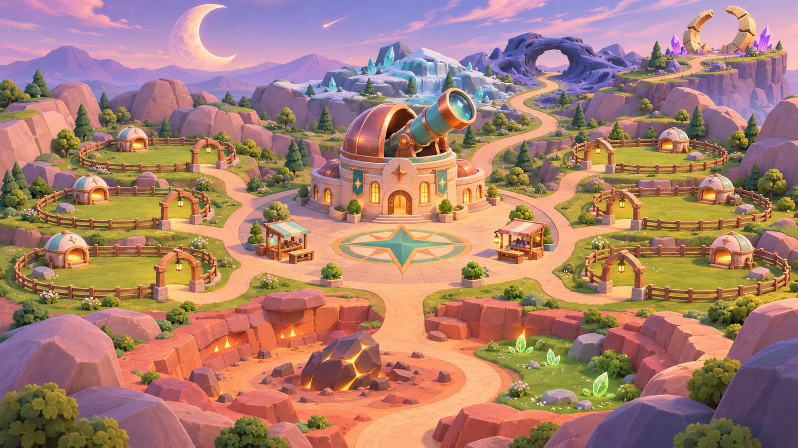

# Starfall Valley world art direction

**Set Starfall Ranch in a bright mountain valley where meteors fall.** The valley feels like a cozy working ranch. The oversized telescope, unusual rock formations, and a crescent moon make its setting recognizable from the first view. Use one connected landscape with six ranches around a shared Observatory plaza. The playable ground, enclosing hills, and distant ridgeline give the map a clear horizon and a sense of place.

The concept shows the intended mood, landmarks, and layout. Use the approved soft-stylized [critter models](./CRITTER_ROSTER.md#visual-reference) as the scale and shape reference. Simplify foliage, stalls, and terrain details for gameplay camera distance.

## What the reference games do well

| Reference | Observation | Use in Starfall Valley |
| --- | --- | --- |
| Grow a Garden | The map brings private plots, shops, and a common event space into one walkable area. | A player can see their ranch gate and the shared plaza from the main path. Shop stalls sit on the plaza edges so the center stays open. [Map and shop guide](https://growagarden.fandom.com/wiki/Map) |
| Bee Swarm Simulator | Distinct fields sit along an uphill progression route. The Mountain Top Gate has a large sculpture that marks the unlock. | Use one recognizable silhouette per route. The Storm arch leads toward a higher Astral Shelf, giving players a visible late-game goal. [Field guide](https://bssmeta.org/guides/fields) · [Mountain Top Gate](https://bee-swarm-simulator.fandom.com/wiki/Lion_Bee_Gate) |
| Fisch | Roslit has a recognizable arrival point with vendors near the docks and separate local fishing areas. | Give the Observatory a clear arrival point and group services there. Give meteor fields their own landmarks and roomy interaction areas. [Roslit Bay](https://fisch.wiki/wiki/roslit-bay/) |
| Anime Dice screenshots supplied by the project lead | Broad approaches and a central landmark make plots and activities easy to read at avatar height. | Preserve broad ranch aisles and clear plaza sightlines. Use original ranch architecture, paths, signs, and props. |

## Location and landmarks

| Location | Placement | What players recognize |
| --- | --- | --- |
| Observatory Plaza | Center | Cream stone observatory with a copper dome, oversized teal telescope, and compass-star paving. Put the **Critter Index** just inside a wide entrance. Workbench, lure kiosk, and contracts sit on the outer ring. Expeditions and brewing have signed access off the main path. |
| Six player ranches | Three west of the hub and three east | Green terraces with low timber fences, open arch gates, name signs, and rounded incubator shelters. Leave the middle aisle free and keep plots visually open to visitors. Keep the tested plot footprint as the starting point. |
| Ember Basin | Short downhill route south | Warm red sandstone, a visible shallow impact crater, and a black rock with amber seams. Leave a wide floor for starter rescues and ordinary Ember landings. Keep the guaranteed first rescue on its short route from the ranch. |
| Verdant pockets | On the Ember and Frost approaches | Small sunny meadows with rounded groves, leaf-shaped crystals, and a leaf trail marker. Use the same vegetation kit in both pockets to help players connect them to the same meteor family. |
| Frost Ridge | Main route north | Pale rock ledges, blue crystal clusters, and one frozen waterfall on the skyline. Keep the playable route wide and use railings where it passes drop-offs. |
| Storm Pass | Between Frost Ridge and Astral Shelf | Wind-carved slate arch, indigo rocks, and angular trail markers. Preserve stable lighting while weather accents and optional effects suggest an exposed ridge. |
| Astral Shelf | Raised overlook beyond the pass | Broken gold stone ring, violet shards, and a clear landing floor. Provide a marked public fall gathering area and a separate approach to ordinary Astral pickups. |

## Sky, terrain, and materials

- Use **bright golden-hour lighting** with a lavender-blue sky, warm sunlight, readable faces, and a pale crescent moon. Use one restrained skybox and a light Atmosphere haze to put distant mountains behind the playable valley. Keep HUD, station prompts, beacons, and path entrances easy to read at minimum graphics settings. [Roblox lighting and effects](https://create.roblox.com/docs/environment) · [Atmosphere](https://create.roblox.com/docs/environment/atmosphere)
- Give the valley a few broad height changes, cream paths, grassy ranch terraces, coral Ember rock, and paler stone as the path climbs. Use Studio terrain for landforms and repeated mesh kits for arches, fences, cliff silhouettes, trees, and crystals. Keep tall props by boundaries and landmarks; leave the play floor clear around interaction prompts. [Roblox environmental terrain](https://create.roblox.com/docs/parts/terrain) · [Roblox environmental art curriculum](https://create.roblox.com/docs/tutorials/curriculums/environmental-art)
- Communicate locations through silhouette, icon, and sign text as well as color. Save the brightest glow and strongest contrast for active meteors and important prompts. Keep ordinary scenery legible with Reduced Motion and static versions of the main cues.

## Production order

1. **Private environment slice.** Dress the Observatory plaza, one representative ranch, and its Ember approach first. Check the look from avatar height at spawn, pen, plaza entrance, and meteor approach. Confirm the Observatory and return route remain visible. Use the slice to set the repeatable terrain, foliage, path, and architecture kits.
2. **Stage 6 world pass.** Apply the ranch kit across all six plots, connect the three fields, and finish the five meteor habitats and the Observatory interior, including the [ranch and hub station models](./ART_DIRECTION.md#launch-station-models). Preserve the existing plot, navigation, station, and spawn anchors during art replacement. Keep paths, stairs, and shop trigger volumes clear. Decorative assets can be collision-free where gameplay permits. Check the existing [plot anchor and station code](../src/Server/Services/PlotService.luau) before replacing placeholder geometry.
3. **Launch verification.** Run the starter rescue and return with all six plots occupied. Check hub and ranch travel, late joins, station reach, prompt overlap, meteor destinations, public fall visibility, and the Critter Index entrance. Compare low-end mobile frame rate and memory against the private baseline, including the existing 30 FPS target, six-player load, and the most crowded event view. Trim optional scenery and effects when they interfere with routes or performance.
